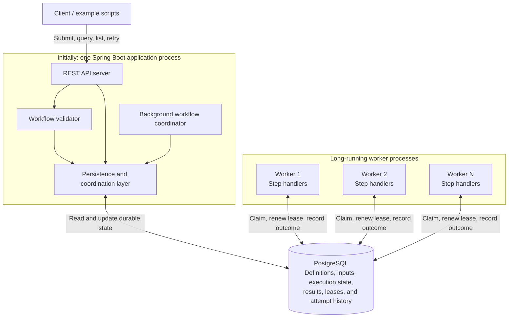
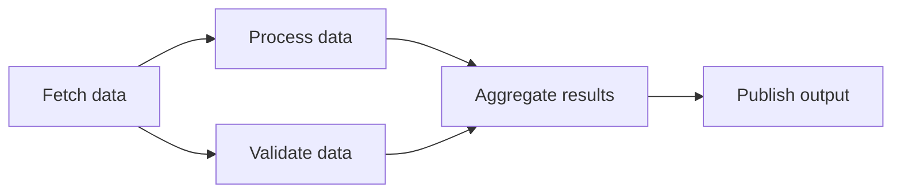
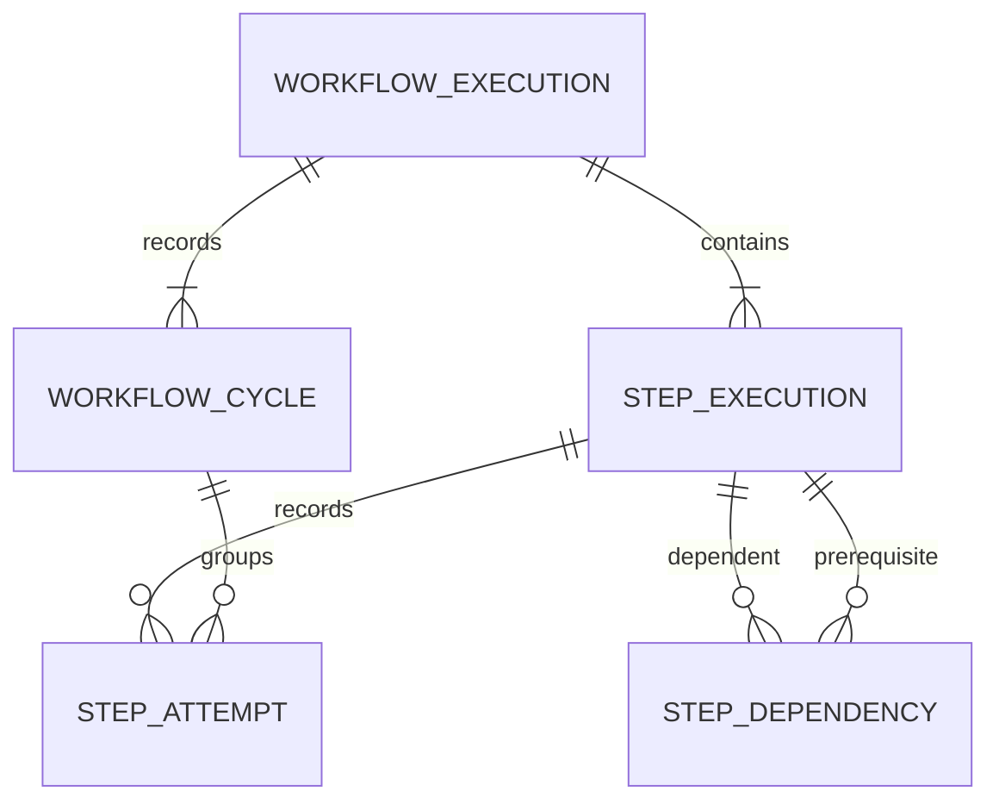
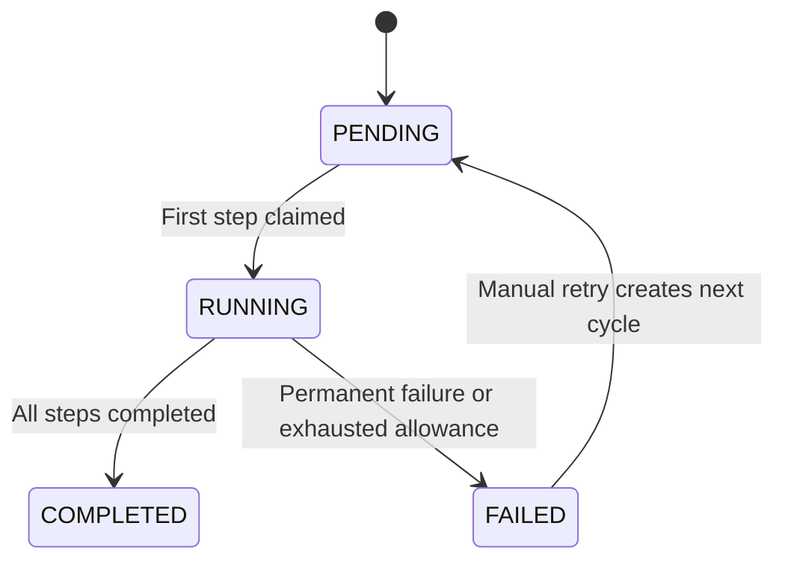
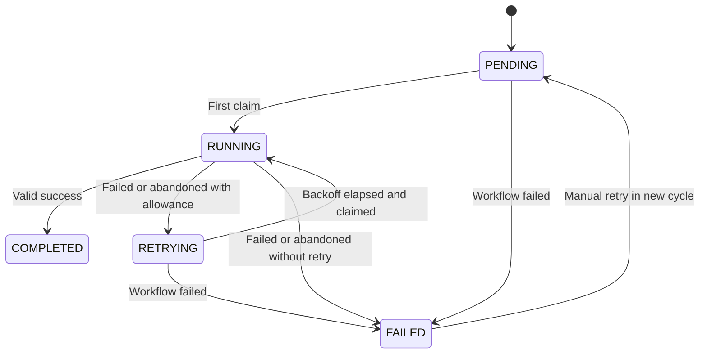
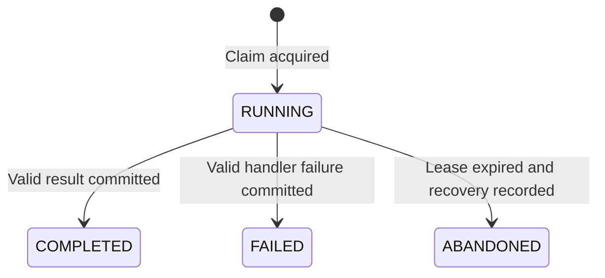

# Distributed Workflow Engine Design

## Status and scope

This document records the agreed architecture, handler contract, REST API and submission schema, persistence schema, execution lifecycle, database coordination behavior, worker operating defaults, and their rationale. It describes the target system; checkpoints are historical, with the latest checkpoint identifying current verified behavior and remaining work.

## Implementation checkpoint: milestone 2

The first implementation uses Java 21, Maven Wrapper 3.9.16, Spring Boot 4.1.1, Spring JDBC, Flyway, and PostgreSQL 18.6. The five-table schema below is applied by `V1__create_workflow_schema.sql`. API/coordinator and worker are separate profiles of one artifact, with the same startup-registered `ECHO` and `DELAY` handlers. The structural submission schema has been extracted to `src/main/resources/schemas/execution-submission.schema.json`.

Implemented routes are submission, execution detail, and step detail. Submission preserves the original definition and persists effective configuration separately. The execution foundation includes dependency eligibility, workflow-guarded transactions, conditional claims and outcome writes, lifetime attempt fencing, step-only lease renewal, independent heartbeat/deadline executors, bounded handler capacity, and terminal outcome reconciliation. Basic retry and workflow-failure transitions are present so the foundation respects the state model; comprehensive failure/retry acceptance remains later work. `retryAllowed` reports state eligibility; the manual-retry endpoint is not yet implemented.

Milestone 2 runs one worker process. Expired-attempt recovery is not implemented: an interrupted attempt remains `RUNNING` after expiry, although its stale renewals and reports are rejected. Parallel DAG and multi-worker/recovery coverage, complete automatic/manual retry scenarios, listing/history APIs, and delivery hardening remain the later milestones in [Plan.md](Plan.md). The target behavior in the rest of this document should not be read as a claim that those milestones are complete.

Verification at this checkpoint: a clean Maven Wrapper build passed 24 unit tests and 21 integration tests against a real PostgreSQL Testcontainers database, without failures or skips. The shared Docker image built successfully; `docker-compose up` started an isolated PostgreSQL/API/worker stack, and the sequential sample completed through HTTP. After restarting both application containers against the same database, execution details and final step results were unchanged. The worker profile was also checked to have no HTTP listener. The extracted Draft 2020-12 schema and sequential sample passed a separate schema-validator check. See [README.md](README.md) for reproducible build and startup commands and current limitations.

## Implementation checkpoint: milestone 3

Milestone 3 extends the verified execution foundation with parallel branch/join coverage and two default Compose worker replicas, each retaining two handler slots. The existing eligibility, claim, and outcome implementation passed the new scenarios without production Java changes, schema changes, new dependencies, or API contract changes. Claims remain competitive; the engine does not promise equal distribution between workers.

Three worker-runtime integration tests use bounded handler gates to demonstrate overlapping branches, a join waiting for both durable outputs, direct dependency data flow, exclusive invocation under two competing runtimes, and capacity limits with excess work left unclaimed. Six additional PostgreSQL lifecycle scenarios cover both guard-acquisition orders for claims versus workflow failure and completion versus failure, failure of retrying siblings, and conflicting concurrent reports. Lock-race tests observe server-side blocking relationships before releasing test locks, rather than assuming transaction order from elapsed time. Workflow transactions serialize ownership decisions; handlers still execute concurrently outside those transactions.

A clean Maven verification passed 24 unit tests and 30 integration tests with no failures or skips. The image built and an isolated `docker-compose up --build -d --wait` started PostgreSQL, API, and both worker replicas. HTTP smoke tests completed the sequential and parallel samples plus a four-branch workflow; persisted attempt timestamps showed branch overlap and correct join ordering, with two concurrent branches owned by each worker in the four-branch case. Every step had one completed attempt. The two-worker configuration and parallel example are documented in README. Expired-attempt recovery and connectivity failures remain milestone 4; complete retry/manual-retry behavior and listing/history APIs remain milestones 5 and 6 respectively. [Milestones.md](Milestones.md) supersedes the older combined milestone breakdown in Plan.md.

## Implementation checkpoint: milestone 4

Expired claims are now recovered by `RecoveryCoordinator` every 5 seconds. `WorkflowStore.recoverExpired()` discovers at most 100 candidates per pass, then rechecks each exact attempt in a short workflow-before-step transaction using current database time after lock acquisition. It records `ABANDONED` with `LEASE_EXPIRED`, clears ownership, and either schedules persisted exponential backoff or fails the step/workflow when allowance is exhausted. Running attempts on failed workflows are also recovered, without automatic retry or replacement of the original cycle error. Repeated/concurrent scans are harmless. No schema or client API changes were required.

Outcome reporting now explicitly reads immutable attempt history after a write exception. This handles a committed completion whose lost response races a heartbeat rejection: the worker recognizes the durable terminal result without rewriting it or reinvoking the handler. An uncommitted write may be retried while local ownership remains valid. Reading an old terminal outcome never renews or revives ownership. Local cancellation logs distinguish deadline expiry, renewal rejection, and shutdown; uncertainty remains separate from confirmed rejection.

Clean Maven verification passed 29 unit tests and 47 PostgreSQL integration tests without failures, errors, or skips. New tests cover recovery/backoff/allowance limits, concurrent recovery, delayed heartbeat commits, database-time checks after lock waits, stale reports, lost claim/result responses, pre-commit result-write failure, local deadlines, independent renewal scheduling, graceful draining, and handlers that ignore interruption. A stale IDE-generated test class encountered during an incremental run was eliminated by clean Maven compilation; no test was skipped or weakened.

The portable `scripts/verify-recovery.py` built an isolated image/Compose stack and passed three actual fault scenarios: worker process death, worker/database network isolation, and a full PostgreSQL pause. Each execution recorded attempt 1 as `ABANDONED`, attempt 2 as `COMPLETED` after backoff, and successful downstream execution. The process-death and partition cases used a different replacement worker. Its temporary configuration uses a 5-second lease; production defaults remain the 30-second lease and 5-second scan. The script removes only its own unique project's containers, network, volume, and image. Milestone 5 and subsequent work have not started.

The initial implementation targets the must-have requirements in [PROJECT_DESCRIPTION.md](PROJECT_DESCRIPTION.md) and follows [AGENTS.md](AGENTS.md). Scalability influences component boundaries and concurrency guarantees from the start, while additional infrastructure and optimizations remain future work. `PROJECT_CONTEXT.md` was referenced in the project instructions but was not present on disk when this document was created.

## Implementation checkpoint: milestone 5

Manual retry is implemented at `POST /api/v1/executions/{id}/retry` through `WorkflowRetryService` and the transactional `WorkflowStore.retry` operation. Under the workflow guard, it requires a failed execution and no running step or attempt records, creates the next pending cycle, resets failed steps, and clears the current finish timestamp. Completed outputs, original definition/inputs, effective policies, first-start timestamp, all previous cycles/attempts, and lifetime fencing counters remain intact. Retry allowances and backoff restart within the new cycle. Rejections use the agreed 400/404/409 error contract, including rejection of any nonempty body. No migration or new dependency was needed.

The startup registry now includes the stateless `FAIL_UNTIL_ATTEMPT` demonstration handler. It requires a nonnegative long integer `failAttempts` and accepts optional boolean `retryable` (default true). It raises `DEMO_FAILURE` while the durable lifetime attempt number is at most the threshold. Success returns `attemptNo`, `cycleNo`, and the stable logical `idempotencyKey`. A new handler object or worker restart cannot reset its failure count. Changing action-specific behavior did not require business-specific branches in orchestration.

Clean Maven verification passed 42 unit tests and 70 PostgreSQL integration tests without failures, errors, or skips. The 23 new PostgreSQL scenarios cover automatic success, backoff doubling/capping without early claims, component reinitialization retaining schedules, permanent/unexpected errors, new-cycle budgets, immutable prior history, reused outputs, stale reports across cycles, running-attempt conflicts, simultaneous retry requests, request validation, and rollback after an injected failure late in the retry transaction.

`scripts/verify-retries.py` reuses the disposable Compose fixture from the recovery checks. Its image build and HTTP/database checks passed automatic retry, manual resumption, permanent failure with explicit manual retry, and a real API/worker stop/start while backoff was persisted. Earlier cycle/attempt rows and completed predecessor output remained unchanged. The script removed only its own temporary resources. Listing and cycle/attempt history APIs remain milestone 6, and final delivery remains milestone 7; neither has started.

## Implementation checkpoint: milestone 6

The three remaining read routes are implemented: execution listing with optional uppercase `status`, cycle history, and attempt history with optional `stepId` and positive `cycleNo`. Responses follow the summary/history fields below and the `items`/`nextCursor` envelope. Page size defaults to 50 and is bounded to 1–200. Unknown parent executions return 404; existing executions with no matching history return empty pages. Reported failure classification, abandonment, preserved results, and cycles remain distinguishable; steps that never acquired work have no synthetic attempt.

`WorkflowQueries` performs read-only queries using repeatable-read transactions, with no lifecycle updates, claims, or ownership renewal. The existing five-table schema and indexes support the routes without migrations or new dependencies. Listing uses one bounded query with summary counts, avoiding an application query per execution. Query parameters and continuation values are bound SQL parameters.

`PageCursor` issues versioned URL-safe Base64 JSON tokens containing the collection/execution, normalized filters, and immutable ordering position. Decoding validates the canonical format and binding. Tokens are opaque client continuation values, not signed credentials or an authorization mechanism; no server-side cursor sessions or signing-secret lifecycle is introduced. Page size is independent of binding and may change between requests. A limit-plus-one query detects whether another page exists. Timestamp ties use the agreed UUID or step/attempt tie-breakers, with mixed-direction comparisons for attempt ordering. Each request has a consistent snapshot; pages across requests do not share one snapshot, and mutable filters may change membership.

Clean Maven verification passed 56 unit tests and 107 PostgreSQL integration tests without failures, errors, or skips. Fourteen new cursor unit cases and 37 new HTTP/database scenarios cover ordering ties, filters, defaults/limits, cross-resource/filter cursor rejection, multi-cycle history, saved results, errors, and all-table comparisons proving inspection does not mutate persisted rows. An initial sandbox-restricted run could not initialize Mockito's attachment support; rerunning with the required process/Docker access passed. No tests were skipped or weakened.

`scripts/verify-history.py` built the image and disposable Compose stack, then passed failed execution listing, paginated failures, cycle ordering, immutable history after manual retry, reused predecessor output, filtering, and invalid-filter errors. It cleaned up its own temporary resources. Milestone 6 changes remain uncommitted for review. Final delivery and fresh-checkout verification remain milestone 7, which has not started.

## Goals

- Execute DAG workflows with sequential dependencies, concurrent independent branches, and joins.
- Preserve definitions, inputs, progress, results, and attempt history across restarts.
- Coordinate multiple workers with atomic claims, leases, and fencing.
- Recover abandoned attempts, enforce retry limits and backoff, and support manual retry.
- Expose submission, listing, status, history, and retry APIs.
- Keep the implementation understandable and reproducible with Java, Maven, Spring Boot, PostgreSQL, and Docker Compose.
- Allow API, coordinator, and worker capacity to grow independently without changing the workflow execution model.

## Architecture

PostgreSQL is the authoritative store for execution state and also acts as the durable work queue. Workers pull eligible work from the database. A background coordinator advances workflows by evaluating persisted state; it does not execute business steps.



These boxes are logical responsibilities, not a requirement for separate services. The outer application box initially contains both the REST API server and the continuously running coordinator. The REST API box itself represents request handling only. Workflow execution continues independently of the HTTP request that submitted it.

### Components

| Component | Responsibility |
| --- | --- |
| REST API server | Accept submissions and expose workflow listing, workflow and step status, execution history, and manual retry. Delegate validation and execution decisions to the corresponding application components. |
| Workflow validator | Reject invalid definitions before execution, including empty DAGs, duplicate step IDs, unknown dependencies, cycles, unsupported action types, and invalid retry settings or input structure. |
| Workflow coordinator | Periodically inspect persisted execution state; make dependency-ready steps eligible; schedule retries; recover expired attempts; determine workflow completion or failure. |
| Worker runtime | Claim eligible steps atomically, invoke handlers, renew leases, and persist outcomes. Use bounded execution concurrency so work does not grow without limit inside a worker. |
| Step handlers | Implement supported Java business actions. Receive workflow inputs, step parameters, and completed dependency outputs; return results or report failures. Do not own orchestration or task-claim logic. |
| Persistence and coordination layer | Provide shared database operations and transactional rules for submission, eligibility, ownership, lease renewal, results, retries, history, and workflow finalization. Both the application and worker runtimes use this code. |
| PostgreSQL | Persist workflow definitions and inputs, workflow and step states, results, attempt history, retry schedules, and ownership information. Coordinate competing processes through atomic database operations. |

### Initial deployment

- One Maven project with shared domain, persistence, and handler code, separated by responsibility.
- One Spring Boot process running the API and coordinator together.
- Initially two long-running worker processes using the same project with a worker runtime profile, each with capacity for two concurrent handlers. Workers are reused across steps; containers are not created per step.
- One PostgreSQL instance with persistent storage.
- Docker Compose starts the application, workers, and database.

Runtime roles should remain separable so that API-only and coordinator-only deployments can be introduced later. Separate repositories or independently developed microservices are unnecessary initially.

## End-to-end flow

1. **Submit and validate.** A client sends a nonempty DAG definition and workflow inputs. The application validates the definition, then atomically persists the definition snapshot, execution, initial cycle, steps, and dependencies. It returns an execution ID after persistence succeeds, without waiting for business execution.
2. **Find eligible work.** The coordinator examines active workflows. Root steps have no dependencies; other steps become eligible only after all dependencies complete successfully. The step's `eligible_at` records the earliest claim time, including backoff for retries.
3. **Claim a step.** An available worker atomically claims an eligible step and records its attempt, owner, lease expiration, and fencing token. The transaction must also ensure the workflow still permits execution. Competing workers cannot obtain the same valid claim.
4. **Execute the handler.** The worker invokes the selected Java handler outside the database transaction and renews its lease while execution continues. Business execution must not hold a database transaction open for the duration of a step.
5. **Persist the outcome.** The worker records success and output, or failure and error details, only while its fencing token and lease remain valid. The attempt outcome and corresponding execution-state change must be recorded consistently.
6. **Advance, retry, or fail.** Successful dependencies allow downstream work to become eligible. Retryable failures and abandoned attempts are retried after backoff when allowance remains and the workflow is active. An explicit permanent failure or exhausted allowance fails the workflow and current cycle. Waiting steps are marked failed; already-running attempts may finish without further automatic retries.
7. **Complete, inspect, or manually retry.** The workflow becomes `COMPLETED` only when all required steps complete successfully. Clients can query persisted progress and history during execution and after restarts. Manual retry resumes a failed execution in a new cycle after all running attempts have settled, reusing completed outputs and granting unfinished steps fresh attempt allowances.

### Example DAG



Processing and validation can run concurrently on separate workers. Aggregation waits for both to complete successfully.

## Java handler contract and registration

### Initial execution model

The initial application supports a predefined set of Java handlers registered at startup. The coordinator is generic: it evaluates dependencies and execution state without understanding what a business action does. `actionType` is an opaque, extensible string used by the worker's registry to select an implementation; `action_type` remains in the persistence schema. It is not a closed enum containing the five operations in the example DAG.

Each handler supplies its action type and is added through a registry operation such as `register(handler)`. Reject duplicate action types at startup. Submission validation rejects unregistered types, and the API and all workers initially use the same supported handler set. Registration is an internal startup operation, not a REST endpoint. Supply a few predefined handlers for the demonstrations; their exact names and business examples are implementation choices.

Adding an action initially means implementing and registering another Java handler, then rebuilding and deploying the application. It does not require changing orchestration, dependency evaluation, claims, leases, retry scheduling, or the database schema. Users can compose different DAGs, use one handler in multiple steps, and configure it with different parameters.

### Interface and context

Use a synchronous Java interface. The following is the intended contract; `JsonNode` denotes Jackson's JSON tree representation, with the concrete dependency version selected when creating the Maven project:

```java
public interface StepHandler {
    String actionType();

    void validateParameters(JsonNode parameters)
        throws StepValidationException;

    JsonNode execute(StepContext context)
        throws StepExecutionException, InterruptedException;
}
```

`validateParameters` checks step configuration during submission without business effects or external calls. Validation that requires dependency results happens during execution. `execute` runs exactly one local invocation for a claimed attempt; it returns an output or reports failure. The runtime never reruns it merely to retry reporting an outcome.

| Context field or operation | Meaning |
| --- | --- |
| `executionId`, `stepId` | Logical work identity. |
| `cycleNo`, `attemptNo` | Diagnostic execution metadata; attempt number is the lifetime number, not a counter reset on manual retry. |
| `workflowInputs` | Immutable submitted workflow inputs. |
| `parameters` | Parameters configured for this step. |
| `dependencyOutputs` | Map from direct prerequisite step IDs to their successful output objects; empty for roots. |
| `idempotencyKey` | Stable key derived from execution ID and step ID, unchanged across attempts and manual retry cycles. |
| `checkCancelled()` | Throws `InterruptedException` when the runtime has given up the attempt or ended shutdown draining; handlers also honor ordinary thread interruption. |

The context exposes no persistence repository, claim operation, heartbeat operation, or workflow-state setter. Claims, renewals, reporting, retries, and cancellation signaling belong to the worker runtime and shared engine services.

Workflow inputs, step parameters, and successful outputs are JSON objects. Use `{}` when no data is needed; a Java null or non-object output violates the handler contract and is treated as a permanent `INVALID_OUTPUT` failure. Each invocation receives isolated input data so mutation cannot change another invocation or persisted configuration. Handlers must be stateless or safe for concurrent invocation.

Expose only direct dependency outputs. Access to another step's result requires declaring that dependency. There is no input-expression language or placeholder substitution initially; handlers explicitly read their parameters, workflow inputs, and dependency outputs.

### Failure classification and idempotency

`StepExecutionException` carries a stable error code, useful message, and `retryable` boolean. Preserve that classification in failed attempt history so clients can understand why an attempt terminated the workflow before its allowance was exhausted.

| Outcome | Runtime behavior |
| --- | --- |
| Explicit retryable failure | Retry within the current cycle's remaining allowance and backoff while the workflow is active. |
| Explicit permanent failure | Fail the step, execution, and current cycle immediately, regardless of remaining allowance. |
| Unexpected ordinary exception | Record a retryable execution failure, bounded by the same attempt allowance. Fatal process/JVM failure is handled through lease recovery rather than converted into an ordinary handler exception. |
| Interruption after ownership loss or shutdown draining ends | Follow local cancellation and abandonment rules; do not report a business failure after giving up ownership. |
| Unexpected interruption while ownership is still valid and the runtime has not cancelled | Record a retryable failure through the guarded outcome path. |
| Database failure while recording an outcome | Reconcile/retry database reporting separately, retaining the handler result while ownership permits; do not classify it as a fresh handler failure or rerun the handler merely to report. |

Permanent failure adds an explicit terminal trigger alongside exhausted attempts; it does not consume or fabricate extra attempts. Manual retry remains available after running attempts settle, with the same fresh-cycle rules. Interruption and local cancellation remain best effort and do not add a public workflow cancellation API.

Handlers do not implement workflow-level retry loops. For external effects, use idempotent operations or a downstream-supported idempotency key. Do not include cycle or attempt numbers in the logical step key: doing so defeats duplicate suppression across retries. A key alone provides no guarantee unless the downstream operation honors it. A new execution has a different key; completed outputs reused by manual retry are not recomputed.

### Future execution without predefined registration

Future versions may accept arbitrary or externally supplied handlers that do not require pre-registration or rebuilding this application. Possible approaches include a generic executor invoking an external endpoint or resolving a dynamically supplied implementation. The mechanism is deliberately undecided and deferred; v1 does not upload code, dynamically load classes from submissions, or execute arbitrary commands.

Such a model still needs an executable target or resolution protocol; removing `actionType` alone does not supply executable behavior. It may evolve or replace the current registry reference when that model is designed. Preserve the separation between execution adapters and orchestration so the change can retain the same claim, lease, fencing, outcome, and retry guarantees. Worker compatibility, target validation, isolation, and implementation/version identity would need explicit design then. This is future flexibility, not a restriction to the illustrative fetch/process/validate/aggregate/publish operations.

## Retry-policy defaults

| Setting | Initial default | Override |
| --- | --- | --- |
| `maxAttempts` | 3, including the first claim | Per step. |
| `backoffInitialMs` | 1000 | Per step. |
| `backoffMaxMs` | 30000 | Per step. |
| Exponential multiplier | 2 | Fixed initially. |

Fill omitted retry fields individually from application configuration. Missing `retry` is equivalent to an empty override object. Validate positive integers and require effective maximum backoff to be at least effective initial backoff; values must fit the Java/PostgreSQL integer types used in the persistence schema. Explicit nulls are invalid. Persist effective values during submission, so later changes to application defaults do not change an existing execution or its manual retries.

With defaults, a retryable failure permits two retries after delays of 1 and 2 seconds. Permanent failures bypass automatic retries. Abandoned attempts count toward allowance, and manual retry grants unfinished steps a fresh allowance using the execution's persisted policy. These are business-step retries; heartbeat retries and database-reporting reconciliation use the separate runtime rules.

## REST API contract

### Resource and routes

Use `/api/v1/executions` for the main resource: each submission creates a run rather than a reusable definition. Payloads use JSON and camelCase; statuses use the uppercase values already defined. Timestamps are UTC strings, with null for unset values. UUID execution IDs and step identifiers are matched exactly; clients encode step IDs as URI path components.

| Method | Route | Successful response |
| --- | --- | --- |
| `POST` | `/api/v1/executions` | `201 Created` after durable submission; execution receipt and `Location` header. |
| `GET` | `/api/v1/executions` | `200 OK`; paginated execution summaries, optionally filtered by `status`. |
| `GET` | `/api/v1/executions/{id}` | `200 OK`; current status, submitted configuration, and step summaries. |
| `GET` | `/api/v1/executions/{id}/steps/{stepId}` | `200 OK`; step configuration, effective retry settings, current output/error, and attempt counts. |
| `GET` | `/api/v1/executions/{id}/cycles` | `200 OK`; paginated cycle history. |
| `GET` | `/api/v1/executions/{id}/attempts` | `200 OK`; paginated attempt history, optionally filtered by `stepId` and `cycleNo`. |
| `POST` | `/api/v1/executions/{id}/retry` | `200 OK` after the manual-retry transaction commits; execution receipt for the new cycle. |

These routes are client-facing; worker coordination uses the database, not additional claim/heartbeat REST endpoints. There are no definition-management, handler-registration, cancellation, or schedule APIs initially.

### Submission example and receipt

The action names and business parameters below are illustrative registered handlers, not an exhaustive action catalog or implementations already delivered. A handler's parameter validator defines its business-specific parameter shape.

```json
{
  "definition": {
    "steps": [
      {
        "id": "fetch",
        "actionType": "FETCH_DATA",
        "parameters": { "source": "demo" },
        "dependsOn": [],
        "retry": {
          "maxAttempts": 3,
          "backoffInitialMs": 1000,
          "backoffMaxMs": 30000
        }
      },
      {
        "id": "process",
        "actionType": "PROCESS_DATA",
        "parameters": {},
        "dependsOn": ["fetch"]
      }
    ]
  },
  "inputs": { "batchId": "batch-001" }
}
```

On successful creation, set `Location` to `/api/v1/executions/{executionId}` and return this receipt:

```json
{
  "executionId": "9b1ea890-c31b-4e64-8153-fb1248445a40",
  "status": "PENDING",
  "currentCycleNo": 1
}
```

The receipt represents the committed submission state, not a guarantee the execution is still pending when the response reaches the client. A subsequent GET may already show progress. `201` indicates resource creation, not completion of business execution. Manual retry accepts no request body and returns the same receipt shape with its newly committed cycle number and initial `PENDING` status. It reuses existing definition, inputs, and effective retry policies.

### Submission JSON Schema

The following JSON Schema Draft 2020-12 defines the request body for `POST /api/v1/executions`. It is embedded here for review and is also available in `src/main/resources/schemas/execution-submission.schema.json`. It does not define the response bodies or handler-specific business parameters. The `actionType` field is a nonblank string, not an enum, so registering another handler does not require changing the structural schema.

```json
{
  "$schema": "https://json-schema.org/draft/2020-12/schema",
  "$id": "urn:dwe:schema:execution-submission:v1",
  "title": "Workflow execution submission",
  "type": "object",
  "additionalProperties": false,
  "required": ["definition"],
  "properties": {
    "definition": { "$ref": "#/$defs/definition" },
    "inputs": {
      "type": "object",
      "additionalProperties": true,
      "default": {}
    }
  },
  "$defs": {
    "nonBlankString": {
      "type": "string",
      "minLength": 1,
      "pattern": "\\S"
    },
    "definition": {
      "type": "object",
      "additionalProperties": false,
      "required": ["steps"],
      "properties": {
        "steps": {
          "type": "array",
          "minItems": 1,
          "items": { "$ref": "#/$defs/step" }
        }
      }
    },
    "step": {
      "type": "object",
      "additionalProperties": false,
      "required": ["id", "actionType"],
      "properties": {
        "id": { "$ref": "#/$defs/nonBlankString" },
        "actionType": { "$ref": "#/$defs/nonBlankString" },
        "parameters": {
          "type": "object",
          "additionalProperties": true,
          "default": {}
        },
        "dependsOn": {
          "type": "array",
          "items": { "$ref": "#/$defs/nonBlankString" },
          "uniqueItems": true,
          "default": []
        },
        "retry": { "$ref": "#/$defs/retry", "default": {} }
      }
    },
    "retry": {
      "type": "object",
      "additionalProperties": false,
      "properties": {
        "maxAttempts": {
          "type": "integer",
          "minimum": 1,
          "default": 3
        },
        "backoffInitialMs": {
          "type": "integer",
          "minimum": 1,
          "default": 1000
        },
        "backoffMaxMs": {
          "type": "integer",
          "minimum": 1,
          "default": 30000
        }
      }
    }
  }
}
```

Unknown structural fields are rejected to catch misspellings; arbitrary business fields are allowed inside `inputs` and `parameters`. Optional fields may be omitted but cannot be explicitly null. JSON Schema `default` values are annotations documenting initial defaults; validators do not automatically insert them. Application normalization supplies missing inputs/parameters as `{}`, dependencies as `[]`, and each missing retry setting from the configured defaults. See the official [Draft 2020-12 validation specification](https://json-schema.org/draft/2020-12/json-schema-validation), [default annotations](https://json-schema.org/understanding-json-schema/reference/annotations), and [object validation guidance](https://json-schema.org/understanding-json-schema/reference/object).

Structural validation is necessary but insufficient. Before persistence, application validation must reject duplicate step IDs, self/unknown dependencies, cycles, unregistered action types, invalid handler parameters, unsupported numeric ranges, and effective maximum backoff below effective initial backoff. These cross-record, registry, and cross-field checks are not enforced by this schema. Preserve the submitted definition snapshot; normalize defaults into the execution records rather than rewriting submitted configuration. Missing workflow inputs are normalized to an empty object for execution.

### Status and history response fields

| Response | Fields |
| --- | --- |
| Execution summary | `executionId`, `status`, `currentCycleNo`, `createdAt`, `firstStartedAt`, `finishedAt`, `runningStepCount`, `retryAllowed`. |
| Execution detail | Summary fields plus submitted `definition`, normalized `inputs`, current-cycle `error`, and `steps` containing `stepId`/`status` summaries ordered by step ID. Outputs and attempt history use their separate endpoints. |
| Step detail | `stepId`, `actionType`, normalized `parameters`, `dependsOn`, `status`, `eligibleAt`, effective `retry`, `attemptsInCurrentCycle`, `lastAttemptNo`, `output`, and `error`. |
| Cycle item | `cycleNo`, `status`, `createdAt`, `startedAt`, `finishedAt`, `failedStepId`, and `error`. |
| Attempt item | `stepId`, `cycleNo`, `attemptNo`, `workerId`, `status`, `startedAt`, `finishedAt`, `result`, and `error`; failed attempt errors also expose the recorded `retryable` boolean. |

Resource errors use `code` and `message`; absent errors, outputs, and results are null. An attempt's `retryable` classification describes its failure, not whether budget remains. For step details, attempt counts are for that step and the execution's current cycle, even when its completed output originated in an earlier cycle. No aggregated workflow output is synthesized initially.

`runningStepCount` includes steps still marked `RUNNING`, even when their lease is awaiting expiry recovery. A workflow can be `FAILED` with running steps. `retryAllowed` is true only for a failed workflow with no unfinished attempts; it is advisory because the retry transaction always rechecks current state. A failed execution's detail exposes the recorded terminal cycle error even if an independent attempt later succeeds.

### Pagination and filters

Executions, cycles, and attempts return an envelope with `items` and `nextCursor`, which is null when no further rows were found. `limit` defaults to 50 with an allowed range of 1 through 200. The next request passes `cursor` unchanged and retains its filters. Reject malformed cursors or a cursor used with different resource/filter values.

- Executions: optional uppercase `status` filter; order by `createdAt DESC, executionId DESC`.
- Cycles: order by `cycleNo DESC` within the execution.
- Attempts: optional `stepId` and positive `cycleNo` filters; order by `startedAt DESC, stepId ASC, attemptNo DESC`. Support this query with a history-order index as recorded in the persistence section.

Use opaque keyset cursors, not offset/page-number pagination. Mutable status filters and ongoing execution mean pages do not form a frozen snapshot. Clients can refresh from the first page for current history. Execution existence is checked for nested collection routes; an existing execution with no matching history returns an empty collection.

### Error responses and uncertain commands

Use one error envelope, with an empty `details` array when no field-specific details apply:

```json
{
  "error": {
    "code": "INVALID_WORKFLOW",
    "message": "Workflow definition is invalid.",
    "details": [
      {
        "path": "definition.steps[1].dependsOn",
        "message": "Unknown dependency 'missing-step'."
      }
    ]
  }
}
```

| HTTP status | Meaning |
| --- | --- |
| `400 Bad Request` | Malformed JSON, invalid identifier/query/cursor, schema violation, invalid DAG, unsupported action, or invalid effective policy/handler parameters. |
| `404 Not Found` | Execution or requested step does not exist. |
| `409 Conflict` | Retry rejected with `WORKFLOW_NOT_FAILED` or `RUNNING_ATTEMPTS_REMAIN`. A concurrent successful retry changes the state and makes another request conflict. |
| `503 Service Unavailable` | Temporary database unavailability. This does not establish that an interrupted command failed to commit. |
| `500 Internal Server Error` | Unexpected server failure. |

Expose stable error codes and useful messages without stack traces; log diagnostic exceptions server-side. Retry accepts no body; a supplied nonempty body is invalid rather than silently changing inputs or policy. HTTP creation/conflict semantics follow [RFC 9110](https://www.rfc-editor.org/rfc/rfc9110.html).

Submission initially has no durable HTTP idempotency key; repeating POST can create another execution. A lost response requires reconciliation rather than blind automatic resubmission. The retry endpoint also checks current state rather than deduplicating a request identity; repeating it after a later cycle has failed can start another cycle. Durable HTTP command deduplication is a future improvement, distinct from business-handler idempotency and internal database-outcome reconciliation.

## Persistence model

### Definitions, executions, cycles, and attempts

- A **definition** describes the DAG, actions, parameters, and retry settings.
- An **execution** is one submission of that definition and workflow inputs. It has its own execution ID, state, and results.
- A **cycle** is the initial execution cycle or a subsequent manual retry within the same execution. It scopes attempt allowances and retains workflow-level outcomes.
- An **attempt** is one successfully claimed execution of one step by a worker. Automatic retries create attempts within the current cycle.

The definition is stored as an immutable JSON snapshot on the execution; there is no separate definition table or definition-management API initially. A snapshot is the saved configuration submitted for that execution, not a separate workflow object. Submission also creates normalized step and dependency records for scheduling. Write both representations in one transaction; action configuration and dependencies remain immutable afterward. The snapshot is the audit record, while the normalized records drive execution.

Submitting the same definition again creates a new execution and reruns all steps, potentially with different inputs. Manual retry keeps the existing execution ID, definition, and inputs; it reuses completed outputs and starts another cycle for unfinished work. The snapshot freezes configuration, not deployed Java handler code; exact reproduction across software upgrades would require additional versioning.



### Schema conventions

The following logical schema is implemented by the initial Flyway migration. Columns are required unless marked nullable. Timestamps use PostgreSQL `TIMESTAMPTZ`, structured payloads use `JSONB`, and statuses use `TEXT` with allowed-value check constraints. Inputs, parameters, and successful outputs follow the JSON-object handler contract and the submission schema above. Creation and update timestamps use database time. Runtime and database validation additionally cap backoff at 9,000,000,000,000,000 milliseconds so conversion to PostgreSQL intervals and future eligibility timestamps stays within the supported finite range; accepting every positive `BIGINT` would overflow those timestamp operations. This is a storage-range check, separate from the normal 30,000 ms default cap.

### `workflow_execution`

One row per submission. Definition and inputs remain unchanged across manual retries.

| Column | Type | Meaning |
| --- | --- | --- |
| `id` | UUID, primary key | Execution identifier. |
| `definition_json` | JSONB | Immutable submitted definition snapshot. |
| `inputs_json` | JSONB | Immutable workflow inputs. |
| `status` | TEXT | `PENDING`, `RUNNING`, `COMPLETED`, or `FAILED`. |
| `current_cycle_no` | INTEGER | Current cycle number, initially 1. |
| `created_at` | TIMESTAMPTZ | Submission time. |
| `first_started_at` | TIMESTAMPTZ, nullable | First successful step claim across all cycles; never reset. |
| `finished_at` | TIMESTAMPTZ, nullable | Current cycle's workflow completion or failure time; cleared on manual retry. |
| `updated_at` | TIMESTAMPTZ | Most recent workflow-state change. |

### `workflow_cycle`

Retains workflow-level outcomes when manual retry reopens an execution. For example, one execution may have cycle 1 failed, cycle 2 failed, and cycle 3 completed. The current execution status mirrors its current cycle; updates to both are transactional.

| Column | Type | Meaning |
| --- | --- | --- |
| `workflow_id` | UUID | Parent execution. |
| `cycle_no` | INTEGER | Initially 1; incremented on manual retry. |
| `status` | TEXT | `PENDING`, `RUNNING`, `COMPLETED`, or `FAILED`. |
| `created_at` | TIMESTAMPTZ | Submission or manual retry time. |
| `started_at` | TIMESTAMPTZ, nullable | First successful step claim in this cycle. |
| `finished_at` | TIMESTAMPTZ, nullable | Workflow completion or failure time for this cycle. |
| `failed_step_id` | TEXT, nullable | Step whose permanent failure or exhausted allowance caused this cycle to fail. |
| `error_code` | TEXT, nullable | Machine-readable failure reason. |
| `error_message` | TEXT, nullable | Failure explanation. |

**Primary key:** `(workflow_id, cycle_no)`. The cycle remains `FAILED` even if another already-running step subsequently succeeds. Its `finished_at` records workflow failure, not the time all outstanding handlers stop.

### `step_execution`

One row per DAG node, holding current state and ownership. Successful outputs are retained when the execution is manually retried.

| Column | Type | Meaning |
| --- | --- | --- |
| `workflow_id` | UUID | Parent execution. |
| `step_id` | TEXT | Step identifier from the definition. |
| `action_type` | TEXT | Java handler to invoke. |
| `parameters_json` | JSONB | Immutable step parameters. |
| `max_attempts` | INTEGER | Allowed attempts per cycle, including the first claim. |
| `backoff_initial_ms` | BIGINT | Initial retry delay. |
| `backoff_max_ms` | BIGINT | Maximum retry delay. |
| `status` | TEXT | `PENDING`, `RUNNING`, `COMPLETED`, `FAILED`, or `RETRYING`. |
| `eligible_at` | TIMESTAMPTZ, nullable | Earliest claim time; null means not eligible. |
| `last_attempt_no` | BIGINT | Lifetime attempt counter and fencing token; initially 0 and never reset. |
| `worker_id` | TEXT, nullable | Current claim owner. |
| `lease_expires_at` | TIMESTAMPTZ, nullable | Current ownership expiration. |
| `output_json` | JSONB, nullable | Successful output. |
| `error_code` | TEXT, nullable | Latest failure or workflow-blocking reason. |
| `error_message` | TEXT, nullable | Explanation of that reason. |
| `created_at` | TIMESTAMPTZ | Step creation time. |
| `updated_at` | TIMESTAMPTZ | Most recent step-state change. |

**Primary key:** `(workflow_id, step_id)`. A step is uniquely identified within its execution; a separate generated step ID is unnecessary. Ownership lives on this current-state row, while attempt rows preserve historical worker identities and outcomes.

### `step_dependency`

One row per DAG edge.

| Column | Type | Meaning |
| --- | --- | --- |
| `workflow_id` | UUID | Execution containing both steps. |
| `step_id` | TEXT | Dependent step. |
| `depends_on_step_id` | TEXT | Prerequisite step. |

**Primary key:** `(workflow_id, step_id, depends_on_step_id)`. Both step references use composite foreign keys into `step_execution`, preventing cross-execution dependencies. Reject self-dependencies in the database and validate longer cycles before persistence.

### `step_attempt`

One row per successful claim, including claims abandoned after lease expiry. An unexecuted step failed because its workflow failed has no fabricated attempt.

| Column | Type | Meaning |
| --- | --- | --- |
| `workflow_id` | UUID | Parent execution. |
| `step_id` | TEXT | Executed step. |
| `attempt_no` | BIGINT | Lifetime attempt number, also used as its fencing token. |
| `cycle_no` | INTEGER | Cycle in which the attempt was claimed. |
| `worker_id` | TEXT | Worker that acquired the claim. |
| `status` | TEXT | `RUNNING`, `COMPLETED`, `FAILED`, or `ABANDONED`. |
| `started_at` | TIMESTAMPTZ | Claim acquisition time. |
| `finished_at` | TIMESTAMPTZ, nullable | Time the terminal outcome was recorded. |
| `result_json` | JSONB, nullable | Successful attempt result. |
| `error_code` | TEXT, nullable | Failure or abandonment reason. |
| `error_message` | TEXT, nullable | Error details. |
| `failure_retryable` | BOOLEAN, nullable | Reported failure classification, required for `FAILED` attempts and null for other attempt states. |

**Primary key:** `(workflow_id, step_id, attempt_no)`. Foreign keys reference the step and cycle within the same execution. On claim, increment `step_execution.last_attempt_no` and copy it to the attempt in the same transaction. Recording success writes the attempt result and current step output together. Terminal attempts are immutable; manual retry creates new attempts rather than rewriting history.

### Constraints and indexes

- All execution, cycle, and step relationships use foreign keys. `workflow_cycle.failed_step_id`, when present, references a step within that execution.
- The execution's `(id, current_cycle_no)` references `workflow_cycle` through a deferred foreign key, allowing initial execution and cycle creation in one transaction despite their mutual references.
- Cycle and attempt numbers are positive; `last_attempt_no` starts at 0. Require `max_attempts >= 1`, positive backoff values, and `backoff_max_ms >= backoff_initial_ms`.
- A step has both `worker_id` and `lease_expires_at` exactly when its state is `RUNNING`. Clear both when the attempt becomes terminal.
- A non-null `eligible_at` is permitted only for `PENDING` or `RETRYING` steps. Clear it on claim or terminal failure.
- Attempts, cycles, and the current workflow have a non-null `finished_at` exactly when their respective state is terminal.
- Inputs and parameters are JSON objects. Step output and attempt result are non-null JSON objects exactly for `COMPLETED` records; use `{}` for successful work without output. Failed attempts have a non-null `failure_retryable` classification; other attempt states leave it null. Lease abandonment follows infrastructure retry policy rather than a reported handler classification.
- A unique partial index on `(workflow_id, step_id)` where attempt status is `RUNNING` prevents two unfinished attempt records for the same step. Recovery must close an expired attempt before another claim is created.
- Dependency satisfaction and agreement between current-state and history rows require transactional operations; they cannot be expressed as ordinary row-level check constraints.

| Access pattern | Index beyond primary keys |
| --- | --- |
| Workflow listing | `workflow_execution(created_at, id)` |
| Active workflow discovery | Partial index on `workflow_execution(id)` for `PENDING` and `RUNNING` workflows. |
| Claimable work | Partial index on `step_execution(eligible_at, workflow_id, step_id)` for `PENDING`/`RETRYING` rows with non-null eligibility. |
| Expired leases | Partial index on `step_execution(lease_expires_at, workflow_id, step_id)` for `RUNNING` rows. |
| Find downstream steps | `step_dependency(workflow_id, depends_on_step_id, step_id)` |
| Per-cycle history and attempt counting | `step_attempt(workflow_id, cycle_no, step_id, attempt_no)` |
| Attempt-history cursor ordering | `step_attempt(workflow_id, started_at DESC, step_id, attempt_no DESC)` |

There is no worker registry table initially. Step leases provide the ownership information needed for recovery; worker membership tracking is not required for claiming work.

## Execution lifecycle

### Workflow and cycle transitions



The diagram describes the execution's current status. An individual cycle never reopens after reaching `FAILED` or `COMPLETED`; manual retry creates another cycle.

| Transition | Trigger and required effect |
| --- | --- |
| Creation in `PENDING` | Persist a validated nonempty DAG, inputs, initial cycle, steps, and dependencies atomically. Invalid submissions do not create an execution. |
| `PENDING -> RUNNING` | First successful claim in the current cycle; set that cycle's `started_at` and set execution `first_started_at` only if absent. |
| `RUNNING -> COMPLETED` | All steps are `COMPLETED`; finalize execution and current cycle together. |
| `RUNNING -> FAILED` | A step reports a permanent failure or exhausts its allowance; fail execution and current cycle, retain the triggering failure, and fail all waiting steps together. |
| `FAILED -> PENDING` | Manual retry after running attempts settle; create the next cycle, reset failed steps, and clear execution `finished_at`. |

There are no new claims for a `FAILED` or `COMPLETED` workflow. Late step completion cannot reverse a workflow's terminal outcome. Starting a full new run requires a new submission rather than reopening a completed execution.

### Step transitions



| Transition | Meaning |
| --- | --- |
| `PENDING -> RUNNING` | Dependencies are complete, eligibility has arrived, and an atomic claim succeeds. |
| `RUNNING -> COMPLETED` | The current worker records success while its claim and lease are valid; clear current step error fields and retain errors in attempt history. This remains allowed after another step has failed the workflow. |
| `RUNNING -> RETRYING` | The attempt has a retryable failure or is abandoned, allowance remains, and the workflow is still active. Persist the next eligibility time. |
| `RETRYING -> RUNNING` | Backoff has elapsed and a new valid claim is acquired. |
| `RUNNING -> FAILED` | The failure is permanent, no attempt allowance remains, or the attempt fails/is abandoned after the workflow has already failed. |
| `PENDING/RETRYING -> FAILED` | Workflow failure blocks further execution. Record `WORKFLOW_FAILED` without inventing an attempt. |
| `FAILED -> PENDING` | Manual retry starts a new cycle; clear current error details and eligibility, retaining earlier history and the lifetime fencing counter. |

Completed steps are not reset by manual retry. Their outputs remain available to dependencies. A step marked `FAILED` with `WORKFLOW_FAILED` may never have executed, or may have been waiting for another attempt; its attempt history distinguishes these cases.

### Attempt transitions



`FAILED` means the worker reported an execution failure. `ABANDONED` means the engine lost valid ownership without recording an outcome, such as after a crash or connectivity failure; it does not assert that the handler stopped running. Once terminal, an attempt cannot accept a late result or renew ownership. Attempt finalization and the corresponding step transition occur in one transaction.

### Eligibility and retry allowances

`eligible_at` separates scheduling eligibility from public step status:

- A newly created step is `PENDING` with null eligibility. The coordinator sets eligibility after all dependencies complete; root steps have no dependency barrier.
- A `RETRYING` step has an eligibility time representing the end of its backoff.
- An eligible step whose time has arrived may still be waiting for worker capacity.
- Claiming requires `PENDING` or `RETRYING`, arrived eligibility, and an active workflow, checked atomically against database time. No additional public `READY` state is needed.

The persistence design uses `max_attempts`, including the initial attempt, to avoid ambiguity between attempts and retries. Every successfully claimed attempt counts against its step's allowance in that cycle, including attempts later abandoned. Unclaimed work does not consume allowance. Count attempts by step and cycle while protecting the claim transaction from concurrent updates.

Use capped exponential backoff with multiplier 2. After the nth retry-eligible unsuccessful attempt in the current cycle, delay the next attempt by `min(backoff_max_ms, backoff_initial_ms * 2^(n - 1))`, calculated without arithmetic overflow. Persist the effective limit and backoff values on the step. Permanent failures skip backoff and immediately fail the workflow; retryable errors and abandonment obey the allowance. Initial retry defaults are 3 attempts, 1000 ms initial backoff, and 30000 ms maximum backoff, as defined above. Lease and heartbeat defaults are defined under **Worker runtime and operating defaults**.

### Workflow failure and manual retry

When a step reports a permanent failure or exhausts its allowance, atomically fail the workflow and current cycle and mark all `PENDING`/`RETRYING` steps `FAILED` with `WORKFLOW_FAILED`. Completed steps and their outputs remain intact. Already-running attempts may renew valid leases and record their actual outcomes, but receive no further automatic retries. Their success does not reopen the workflow or make downstream work eligible.

Recovery must continue examining running leases even for failed workflows. An expired attempt becomes `ABANDONED`; its step becomes `FAILED` without another automatic attempt. Marking a step failed does not cancel external actions, and no rollback is implied.

Manual retry is permitted only for a failed execution with no remaining `RUNNING` attempts. Expired attempts must be recovered before retry is accepted. A still-valid attempt blocks retry even if the workflow is already failed. In one transaction:

1. Verify the failed status and absence of unfinished attempts.
2. Create the next `PENDING` cycle and update the execution's current-cycle reference and status; clear its `finished_at`.
3. Preserve completed steps and outputs. Reset failed steps to `PENDING`, clearing current errors and eligibility.
4. Leave definition, inputs, prior cycles, prior attempts, and lifetime attempt counters unchanged. The new cycle gives unfinished steps fresh attempt allowances.

For `A -> B -> C`, if A completed, B exhausted its allowance, and C never ran, manual retry reuses A's output, retries B, then executes C. A full new submission executes all three again. Completed work is reused without checking external freshness; use a new execution if inputs, definition, or all business effects must be refreshed.

Settled attempts do not guarantee all stale external code has stopped. Idempotency remains necessary even after manual retry passes its ownership checks.

## Database coordination protocol

### Chosen approach: workflow-row lock plus conditional updates

Use one explicit workflow-row lock as the shared coordination point for claims, dependency promotion, outcome finalization, workflow failure/completion, recovery, and manual retry. Within that short transaction, use conditional step updates wherever sufficient, rather than automatically issuing a separate explicit lock query for every step and attempt. Ordinary updates still acquire database locks; this approach reduces explicit lock management rather than eliminating locking.

Acquire the workflow lock before modifying its step and history records. When an operation must explicitly lock multiple step rows, determine the affected set and acquire those locks in step-ID order. Recheck conditions under the relevant locks. Heartbeats are the exception: they perform a conditional ownership update on one step and never acquire the parent workflow lock afterward. Keep all handler code and external calls outside these transactions.

This serializes short state-changing decision transactions within one workflow, while handlers and different workflows run concurrently. The persistence layer owns these rules through operations such as claim, renew, record outcome, recover, and retry; callers and business handlers do not reproduce them independently.

Use database wall-clock time for lease decisions, evaluated at the guarded mutation after any relevant lock wait. A timestamp fixed at transaction start may already be stale by then. The SQL must preserve that ordering; explicitly lock the target step where needed to make the time check reliable. The workflow lock alone does not prevent a lease renewal from changing a step's expiration.

### Claim

An idle worker first reserves a local handler slot, then discovers a candidate. Candidate discovery establishes no ownership. Under the workflow lock, recheck that:

- The workflow is `PENDING` or `RUNNING` and the claim belongs to its current cycle.
- The step is `PENDING` or `RETRYING`, its eligibility has arrived, and every dependency is `COMPLETED`.
- The step has remaining attempt allowance in this cycle.

In one transaction, increment the lifetime attempt/fencing counter, assign the worker and lease, clear eligibility, mark the step `RUNNING`, and insert its attempt. On the first claim of a cycle, also mark execution and cycle `RUNNING` and set their applicable start timestamps. If conditions no longer match, return no claim without creating an attempt.

Start the handler only after the claim commit is confirmed and the worker's conservative local ownership window remains valid. A worker that loses the competition releases its reserved slot and can look for other work. Workers do not directly take over expired `RUNNING` claims; recovery must first close the previous attempt.

### Renewal and fencing

A heartbeat extends the lease only if the step is `RUNNING`, the worker ID and attempt token match, and the existing lease is still unexpired at the guarded update. A successful renewal sets a new expiration based on current database time. It does not increment the fencing token or create an attempt.

An expired lease cannot be revived. A valid running attempt may still renew after another step has failed the workflow, because already-running work is allowed to finish. A stale or rejected renewal changes nothing. No heartbeat or per-worker liveness table is needed; ownership is tracked per step.

### Outcome reporting

Acquire the workflow lock and verify the current attempt's worker, token, cycle, running state, and unexpired lease before recording a new outcome. Reject an expired or superseded report without altering current state. Apply the following effects atomically, using the shared engine/persistence operation rather than business-handler code:

| Accepted outcome | Transactional effects |
| --- | --- |
| Success | Complete attempt and step, write result/output, clear current step errors, and clear ownership. |
| Retryable failure with allowance remaining and workflow active | Fail the attempt, record its classification, clear ownership, move the step to `RETRYING`, and persist its next eligibility time. |
| Permanent failure or failure exhausting allowance while workflow active | Fail attempt and step, record its classification, fail execution and current cycle, preserve the triggering error, and fail all waiting steps with `WORKFLOW_FAILED`. |
| Failure after the workflow already failed | Fail attempt and step, record the reported classification, and clear ownership, without scheduling another attempt. |

Permanent workflow failure is applied in this transaction, not deferred to the next coordinator scan. Valid success after workflow failure only completes that step; it never reopens the workflow or promotes downstream work.

### Dependency promotion and workflow completion

The coordinator periodically examines active workflows. Under the workflow lock, make a `PENDING` step eligible only when all prerequisites are complete and eligibility has not already been set. Leave existing eligibility and retry-backoff timestamps intact. Root steps have no dependency barrier.

Finalize execution and current cycle as `COMPLETED` only when the workflow is active and every required step is `COMPLETED`. Repeated scans and competing coordinators must be harmless: they cannot create attempts, duplicate retries, reset backoff, or overwrite terminal outcomes. Workers persist successful results; the coordinator performs dependency promotion and success finalization from durable state.

### Expired-attempt recovery

Discover potentially expired leases, then acquire the workflow lock and recheck the target step and attempt against current database time. A heartbeat may have renewed ownership since discovery. If it is no longer expired or the attempt already settled, do nothing.

For a still-expired claim, atomically mark the attempt `ABANDONED`, record the lease-expiry reason and observation time, and clear ownership. Schedule retry only when the workflow is active and allowance remains. Otherwise fail the step and, if this exhausts allowance on an active workflow, fail execution, cycle, and waiting steps in the same transaction.

The implementation records the reason as `LEASE_EXPIRED` on the attempt and step, with `finished_at` marking observation time. An abandoned attempt does not set `failure_retryable`, which is reserved for handler-reported failures. Candidate discovery is limited to 100 rows per pass; busy workflows are skipped for a later pass. This bounds one scan's work but is not a throughput or starvation guarantee under sustained load.

Scan running leases on failed workflows as well as active workflows. Recovery records abandonment; it does not prove the former handler stopped. Competing recovery scans cannot close the same attempt twice or schedule duplicate work.

### Manual retry and uncertain responses

Manual retry uses the same workflow lock and the lifecycle transaction described above. Recheck failed status and the absence of unfinished attempts under that lock. Two simultaneous requests cannot create two next cycles: after one succeeds, the other finds an active workflow and is rejected as no longer eligible for retry.

A connection can fail after a commit but before its response arrives. Reconcile against durable state before repeating an operation:

- For an uncertain claim, confirm the current claim, attempt identity, ownership, and lease before starting the handler. Do not blindly create another claim. If ownership cannot be confirmed within the local safety window, let database recovery resolve the claim without executing it.
- For an uncertain outcome write, query the attempt. If its terminal outcome was already recorded, return that stored outcome without rewriting it or creating another attempt. Otherwise, retry reporting only while ownership remains valid and the worker has not given up the attempt.
- Do not rerun a handler merely because storing its result failed. Retain its result while attempting safe reporting; if it cannot be recorded before ownership is lost, the engine may later execute another attempt under at-least-once semantics.

`recordedOutcome` performs the read-only terminal lookup for the exact execution, step, attempt, cycle, and worker identity. It may reconcile an in-flight report after local cancellation, but does not permit new writes or renewed execution after cancellation. This avoids relying on the timing of the next heartbeat or a repeated report to recognize a committed outcome.

Database transaction retries, when required after a rollback, repeat only database coordination work, never handler execution or external effects. An uncertain commit requires reconciliation rather than assuming rollback.

### Race-condition alternatives and trade-offs

Ownership validation and concurrency control are separate concerns. Every alternative still needs atomic state changes, attempt limits, leases, and fencing. Conditional updates on only a step cannot protect workflow-wide rules: a worker could read an active workflow, another transaction fail it, and the worker then claim a different step based on the earlier read.

| Approach | Benefits | Trade-offs and decision |
| --- | --- | --- |
| Workflow-row lock plus conditional updates | One shared coordination point makes workflow failure, claims, completion, and manual retry straightforward. Conditional updates avoid unnecessary explicit pre-locking of every record; heartbeats remain independent. | **Chosen initially.** Short decisions within one workflow serialize, so very large workflows may contend on that row. Measure before adding more granular coordination. |
| Optimistic concurrency with version columns | Update only if an expected version still matches; reload and retry on conflict. Useful when conflicts are uncommon. | A step version alone cannot detect workflow failure. Cross-record rules need a shared workflow-version check/update or another protocol. All relevant paths must participate; retries add complexity and a shared version can remain a contention point. |
| Serializable transactions | PostgreSQL detects transaction patterns inconsistent with serial execution, reducing some explicit application-managed locking. | Requires correct business predicates and whole-transaction retries after serialization failures. Adds monitoring/retry costs under contention; does not replace fencing, lease-time checks, or explicitly establishing the required ordering of claims and workflow failure. Deferred in favor of the more explicit initial protocol. |
| Transaction-level advisory lock per workflow | Gives cooperating processes one workflow-level coordination key without explicitly locking the workflow row. PostgreSQL releases it at transaction end. | All relevant code must cooperate and use consistent keys. Adds another locking convention and offers little per-workflow concurrency improvement over locking the existing row. Not selected initially. |
| One authoritative coordinator per workflow | Route state-changing commands through a single owner that processes them sequentially. | Requires command routing, owner assignment, failover, and stale-owner protection. Substantial architectural work compared with the PostgreSQL coordination already required; defer. |

`SKIP LOCKED` may help candidate discovery avoid waiting behind busy rows, but is a queue-access optimization, not a replacement for the workflow gate or fencing checks. Any such optimization must retain workflow-before-step ordering for state changes rather than locking candidate steps first and then their workflow.

These comparisons are design trade-offs, not benchmark results. PostgreSQL documents [row and advisory locks](https://www.postgresql.org/docs/current/explicit-locking.html), [isolation levels and serialization retries](https://www.postgresql.org/docs/current/transaction-iso.html), [SKIP LOCKED](https://www.postgresql.org/docs/current/sql-select.html), and [database time-function semantics](https://www.postgresql.org/docs/current/functions-datetime.html).

## Worker runtime and operating defaults

These are configurable starting defaults, not measured performance claims or hard recovery guarantees. They do not require additional tables or change the execution model.

| Setting | Initial default | Reason |
| --- | --- | --- |
| Lease duration | 30 seconds | Balance crash recovery time against tolerance for temporary delays. |
| Heartbeat interval | 5 seconds | Allow several renewal opportunities before expiration. |
| Worker polling interval when idle | 1 second | Discover available work promptly with modest polling traffic. |
| Coordinator advancement interval | 1 second | Promote dependencies and finalize successful workflows promptly. |
| Expired-lease scan interval | 5 seconds | Recovery can run less frequently than normal advancement. |
| Concurrent handlers per worker | 2 | Demonstrate parallelism with bounded resource use. |
| Database-operation timeout budget | 2 seconds | Bound time spent acquiring a connection and performing a control operation rather than allowing it to hang indefinitely. |
| Local lease safety margin | 5 seconds | Give up before the last confirmed ownership window is expected to expire. |
| Graceful shutdown drain period | 30 seconds | Allow existing attempts to finish without indefinitely delaying shutdown. |

Start with two workers, for up to four concurrent handlers. Environment/application configuration exposes these values. Validate positive durations and capacity, and require heartbeat and database-operation budgets to fit within the lease window with its safety margin. The database-operation budget must be implemented across connection acquisition, lock/query execution, and network handling, rather than assuming one timeout setting covers all stages.

### Capacity and control scheduling

Reserve a handler slot before attempting a claim. Do not prefetch leased steps into an unbounded local queue. Release the reservation when no claim is acquired, or retain it through the actual handler execution. Once capacity becomes free, a worker may poll immediately; use the idle polling interval only when no work is found. Add small randomized idle-poll delays to reduce synchronized queries across workers, and avoid overlapping poll invocations that could over-reserve capacity.

Run heartbeat/control scheduling separately from the handler executor, with sufficient scheduling and database-connection capacity for concurrent renewals. Slow handlers must not starve their own heartbeats, and one delayed database call must not indefinitely block other attempts' renewal tasks. Do not issue overlapping renewal requests for the same attempt or let an older response replace a newer local ownership confirmation.

Use a distinct worker-instance ID for each process startup. A restarted process does not inherit the previous process's claims; their leases are recovered normally. Database ownership is per step, not inferred from a separate list of healthy worker nodes.

### Local ownership tracking and renewal failures

Track a conservative local ownership window using monotonic elapsed time, not comparisons between the worker's wall clock and the database's expiration timestamp. For a confirmed claim or renewal, base the local deadline on the start of that request:

`local deadline = request start + lease duration - safety margin`

With the defaults, the worker gives up roughly 25 seconds after that request began unless a later renewal is confirmed. Starting the window before the database operation accounts conservatively for request/response delays. A response received after that deadline does not authorize starting or resuming a handler. Unconfirmed requests never extend the local deadline. The local deadline is a best-effort guard; database lease/fencing checks remain authoritative, including after a process pause.

| Renewal result | Worker behavior |
| --- | --- |
| Confirmed success | Update the local ownership deadline and continue the attempt. |
| Explicit rejection because ownership, token, state, or lease no longer matches | Immediately give up the attempt and request handler cancellation. |
| Timeout or connectivity error | Treat renewal as uncertain; retry approximately every second, one request at a time, only within the window from the last confirmed claim/renewal. |
| Local safety deadline reached without another confirmation | Give up the attempt even if PostgreSQL might have committed an unacknowledged renewal. |

Giving up is irreversible for that local attempt: stop initiating renewals and outcome writes, request best-effort cancellation/interruption, and discard later handler results. In-flight database operations remain subject to ownership checks and may require reconciliation. Let coordinator recovery decide abandonment and retry; the worker does not overwrite execution state merely because it lost confidence in ownership.

Interruption cannot reliably stop arbitrary Java code or external requests. A handler that ignores interruption continues occupying its execution slot until it actually exits; losing ownership does not free capacity to launch an unbounded number of additional handlers. External side effects can still occur, which is why idempotency is required. Logging must distinguish reported failures, explicit ownership loss, uncertain renewal, and abandonment.

### Shutdown and recovery expectations

On orderly shutdown, stop new claims, keep renewing existing valid attempts, and allow the configured drain period for execution and outcome reporting. At the end of that period, request cancellation and stop renewing unfinished attempts. Container termination settings must allow the drain period plus process-cleanup time. A crash skips draining and is handled through lease expiry.

With a healthy database and available coordinator, expiry should ordinarily be detected within approximately 35 seconds of the last lease extension: the 30-second lease plus up to 5 seconds until the next scan. Backoff, query/lock delays, coordinator load, and worker polling add further time before a replacement starts. This is an operating expectation, not a guaranteed deadline or a per-step execution timeout. Healthy long-running handlers can keep renewing indefinitely; user-configurable execution timeouts remain optional.

## State and reliability guarantees

Workflow, step, and attempt states follow the lifecycle above. Each attempt and workflow cycle retains its own durable history, so automatic and manual retries do not overwrite earlier outcomes. Current step rows are mutable summaries; this schema does not promise a separate audit event for every intermediate step-state change.

### Ownership and concurrency

- Only one worker may hold a valid claim for a step at a time.
- Claims, renewals, and outcome updates use atomic database checks rather than process-local locks.
- Database time determines lease validity, avoiding reliance on agreement between worker clocks.
- Fencing tokens distinguish successive ownership attempts. An expired or superseded attempt cannot renew ownership or overwrite current execution state.
- Dependency promotion, retry scheduling, recovery, and finalization must remain correct when multiple coordinators act concurrently. Starting with one coordinator must not make singleton execution a correctness requirement.
- Essential progress and ownership are stored in PostgreSQL; in-memory state is only temporary execution state or an optimization.
- Scheduling decisions, claims, attempt finalization/recovery, and manual retry use the workflow-row lock plus conditional updates described above. Explicitly lock additional step rows only where needed, preserving workflow-before-step ordering and step-ID order for multiple explicit step locks. Ordinary state/history writes remain transactional.
- Lease renewals use conditional updates on the current step's state, owner, fencing token, and unexpired lease. They remain allowed for valid running attempts after workflow failure and do not require holding a workflow lock during handler execution.
- Workflow failure and claims use the same workflow guard so a step cannot be newly claimed after failure commits. The protocol is settled; concrete SQL, timeout enforcement, and race-case verification are implementation work.

### Failure behavior and consistency trade-offs

| Situation | Intended behavior and limitation |
| --- | --- |
| Worker crashes | Its lease expires. The coordinator records the attempt as abandoned, then retries only if the workflow is active and allowance remains. A replacement worker may execute the step again. |
| Worker loses database connectivity | It cannot renew ownership or commit an outcome. After lease expiry, stale state writes are rejected. An already-running external action may still finish. |
| Coordinator process stops | Persisted progress remains. Coordinator-driven advancement and recovery pause until a coordinator resumes; already-running handlers may continue while their ownership remains valid. |
| API process stops | Clients temporarily lose API access. In the initial combined process, the coordinator also stops. Independent workers and the database retain their own lifecycle. |
| PostgreSQL is unavailable | New submissions, claims, renewals, and durable state changes cannot succeed. Progress requiring those operations pauses until connectivity returns. |
| Handler succeeds externally but its result is not durably recorded | The engine may retry the step and repeat its external effects. |
| A step reports a permanent failure or exhausts retries | The workflow and current cycle fail. Waiting steps fail with `WORKFLOW_FAILED`. Running attempts may finish without automatic retries; manual retry waits for them to finish or be recovered after lease expiry. |

The design favors consistent execution ownership and state over continued scheduling during database partitions. A local PostgreSQL volume preserves data across container restarts; a single database instance does not provide database high availability or protection against disk loss.

### Execution semantics

Execution is **at least once**, subject to configured retry limits. Leases and fencing protect engine state; they do not guarantee exactly-once effects in external systems or prevent all overlap between stale and replacement handler code.

Handlers follow the idempotency and cancellation assumptions in the handler contract above. Guaranteed cancellation of external work, user-facing workflow cancellation, and compensation are outside the initial scope; best-effort local handler interruption on ownership loss or shutdown is part of worker behavior. Lease-based crash recovery is required even though user-configurable execution timeouts are optional.

## Design choices and rationale

The following records the choices agreed in discussion and the alternatives they avoid. Alternatives are architectural comparisons, not claims that prototypes or benchmarks have been performed.

| Choice | Reason | Alternative and trade-off |
| --- | --- | --- |
| Use PostgreSQL for both durable state and task discovery initially | Keeps ownership, results, and workflow transitions close to one transactional source of truth while minimizing infrastructure for the assignment. | A separate broker can improve task delivery characteristics at scale, but adds delivery/acknowledgment behavior and database-to-broker consistency concerns. Revisit only when measured needs justify it. |
| Combine API and coordinator in one initial process, with separate logical components | Reduces deployment complexity while preserving clear responsibilities and an independent background execution loop. | Separate services allow independent scaling and failure isolation immediately, but increase initial operational work. Preserve runtime-role boundaries so separation is possible later. |
| Run business logic in independent, long-running workers | Worker capacity can scale independently of request handling and orchestration, without per-step process startup. | Executing handlers inside request handling ties execution to API lifecycle and capacity. Creating containers per step adds orchestration overhead outside the must-have scope. |
| Pull work from PostgreSQL using atomic claims | Provides a simple durable handoff and safe competition among multiple workers. | Direct in-memory dispatch would need additional durable handoff and recovery mechanisms. Polling introduces database load and scheduling latency that must be measured and tuned. |
| Use leases plus fencing | Leases allow recovery after worker loss; fencing prevents stale attempts from corrupting newer state. This is also required by AGENTS.md. | A permanent owner can strand work after a crash. A lease without fenced writes leaves stale-result races. Neither approach guarantees exactly-once external effects. |
| Design concurrency-safe coordinator operations from the start | Allows future coordinator replication without changing fundamental state-transition rules. | Relying on a single process or local locks initially would embed assumptions that become unsafe with multiple coordinators. Actual multi-coordinator deployment remains future work. |
| Store the definition snapshot on each execution; defer a separate definition table | Each submission already supplies its definition and inputs. Keeping them together avoids a separate definition identity, lifecycle, and management API while preserving submitted configuration. | A reusable definition/version table is useful when many executions reference a saved definition, particularly for recurring schedules. Revisit then; retain per-execution snapshots so later definition changes cannot alter existing runs. |
| Materialize steps and dependencies alongside the snapshot | Scheduling can query indexed relational records without repeatedly parsing the full definition. Same-execution foreign keys enforce dependency integrity. | Keeping only JSON would simplify submission storage but complicate task claims, dependency queries, and concurrent step updates. Maintaining both representations requires atomic creation and immutable configuration. |
| Separate step state, attempt history, and workflow cycles | Current-state reads stay straightforward; every worker attempt and manual-retry outcome remains visible. Cycles scope fresh attempt allowances without resetting fencing tokens. | Overwriting current rows alone loses history. A linked new execution for each manual retry is possible but was declined in favor of resuming the same execution ID and completed outputs. |
| Represent readiness with `eligible_at` | Distinguishes dependency waiting, retry backoff, and available work without expanding the required public step states. | A separate `READY` state would add transitions while still needing a timestamp for backoff. Claims must check eligibility and workflow status atomically either way. |
| Fail waiting work and let active attempts finish after workflow failure | Stops new execution while retaining truthful outcomes and avoiding cancellation machinery. `WORKFLOW_FAILED` distinguishes blocked work from handler failure. | Immediately failing and fencing active attempts rejects potentially useful results without reliably stopping external effects. The chosen policy can delay manual retry while a healthy attempt continues to hold its lease. |
| Resume manual retry in a new cycle, preserving completed outputs | Avoids repeating successful work, keeps one execution identity, and preserves prior failures and attempt allowances. | Starting over is available through a new submission. Reusing outputs assumes their continued validity; refreshing inputs or all effects requires a new execution. |
| Count abandoned claims toward a cycle's attempt limit | Gives crashes and repeated connectivity failures a bounded recovery policy. A successful claim, rather than a reported handler result, defines an attempt. | Excluding abandoned claims could retry indefinitely. This choice can exhaust allowance without a confirmed business failure; history exposes that distinction. |
| Use a workflow-row lock plus conditional updates for coordination | Gives workflow-wide decisions one guard while avoiding unnecessary explicit pre-locking of every step/history row. Heartbeats remain independent and locks never span handler execution. | Optimistic versions, serializable transactions, advisory locks, and a single authoritative coordinator were compared under **Race-condition alternatives and trade-offs**. All retain ownership checks; each adds retries, conventions, or infrastructure. Revisit if measured contention warrants it. |
| Renew a 30-second lease every 5 seconds, using a conservative local safety window | Tolerates brief delays while allowing reasonably prompt crash recovery. Local monotonic tracking avoids comparing unsynchronized worker/database wall clocks. | Shorter leases recover faster but increase false abandonment; longer leases delay recovery. Unconfirmed renewals never extend the worker's local window. Defaults remain tunable, and database fencing remains authoritative. |
| Distinguish definite renewal rejection from uncertain connectivity | Reject stale owners immediately while permitting bounded renewal retries after temporary failures. Stop initiating work/results when the safety window ends. | Abandoning on every transient error causes unnecessary retries; continuing without a confirmed deadline risks prolonged stale execution. Cancellation remains best effort and slots stay occupied until handlers exit. |
| Bound worker concurrency and separate heartbeats from handlers | Prevents leased work from waiting behind an unbounded local queue and prevents slow handlers from starving renewal. Two workers with two slots each demonstrate parallel execution. | Higher concurrency can improve throughput but increases database/downstream pressure. Tune capacity and connection budgets together rather than merely adding threads. |
| Poll for advancement and recovery with configurable intervals | Keeps durable scheduling simple without introducing a broker or worker registry. | Polling adds latency and database traffic; shorter intervals trade load for responsiveness. Notifications or different delivery mechanisms remain future options if measurements justify them. |
| Drain on shutdown, then cancel locally and let leases expire | Gives in-flight attempts a chance to finish while bounding orderly shutdown time. | Immediate shutdown creates avoidable abandoned attempts; unlimited draining can block deployment indefinitely. External actions may continue after cancellation. |
| Keep `actionType` and pre-register Java handlers initially | Meets the assignment's per-step type/action requirement and provides simple, deterministic dispatch. Supported handlers are a predefined deployment set; the orchestration engine treats their names as opaque references. | Removing the field alone leaves behavior selection undefined. Arbitrary handlers without registration may be supported through a future execution adapter, but need a target/resolution protocol; they are not part of v1. |
| Use synchronous handlers with JSON-object inputs and outputs | Fits bounded worker execution and PostgreSQL JSON storage without coupling the engine to a Java DTO for every action. Direct dependency outputs make data flow explicit. | Handler-level validation is required; typed per-action contracts, expression-based binding, and asynchronous handler APIs add complexity and are deferred. |
| Distinguish retryable and permanent handler failures | Transient failures receive bounded retries; known permanent errors fail promptly and remain visible in history through their classification. | Retrying every failure is simpler but wastes allowance on deterministic errors. Explicit classification broadens the terminal trigger beyond retry exhaustion; unknown ordinary exceptions remain retryable and bounded. |
| Persist effective retry defaults at submission | Per-step overrides are easy to understand, while application configuration changes cannot silently alter running executions or manual retry cycles. | Looking up current defaults on every claim would make execution depend on deployment changes. |
| Use execution resources, separate history endpoints, and cursor pagination | Aligns the API with the persisted execution/cycle/attempt model, keeps routine status responses manageable, and supports growing history without large offsets. | Pages are not frozen snapshots. Definition management and a single combined unbounded history response are unnecessary initially. |
| Publish a structural submission schema and apply semantic validation separately | Clients can check types and required fields while the application validates registry membership, DAG constraints, handler parameters, and effective policy. | Encoding registered action names as a schema enum would require schema edits whenever a handler is added. Schema defaults are annotations, not runtime normalization. |
| Keep the first release focused on must-have behavior | Correct execution, recovery, and reproducible verification take priority within the assignment's time constraints. | Additional infrastructure, dashboards, and advanced workflow features increase scope before the execution model is verified. |

As detailed decisions are made, extend this record with the selected behavior, reasons, alternatives considered, and consequences. Keep proposals and unresolved questions distinct from agreed decisions.

## Scalability and future improvements

| Area | Initial implementation | Future improvement and reason to revisit |
| --- | --- | --- |
| API capacity | One API instance; no essential execution state kept in API memory. | Deploy stateless API instances behind a load balancer when request volume or availability requires it. |
| Coordinator capacity | One coordinator using concurrency-safe state transitions. | Run multiple coordinators; later partition responsibility by workflow if scans or lock contention limit throughput. Concurrent coordinators must be tested before claiming support. |
| Worker capacity | Multiple workers, bounded concurrency, and claims limited to available execution capacity. | Add workers independently; consider action-specific worker pools when workloads need different resources. Adding workers is limited by database and downstream capacity. |
| Database workload | PostgreSQL-backed task discovery with indexes supporting eligibility, retry, and lease queries. | Measure query load and contention; tune polling, batching, and connection budgets before introducing new infrastructure. Avoid claiming more work than workers can execute. |
| History and results | Store results and attempt history durably in PostgreSQL. | Introduce pagination, retention/archival policies, and potentially external storage for large outputs as data volume warrants. |
| Availability | One application/coordinator process and one database instance. | Separate application roles and introduce database high availability and backup/recovery procedures when deployment requirements justify them. |
| Task delivery | Database polling without a broker. | Consider notifications or a broker if measured discovery latency or polling load becomes unacceptable. Any change must preserve durable handoff and claim/fencing guarantees. |
| Reusable definitions and recurring execution | Immutable definition JSON on each submitted execution; no separate definition or schedule table. | Add reusable definitions/versions and schedule records when recurring execution is introduced. Each scheduled occurrence creates an execution with its own snapshot and inputs. Separate definitions are useful for reuse, though recurring execution does not strictly require them. |
| Arbitrary execution implementations | Predefined Java handlers registered at startup; `actionType` selects a handler consistently across API and workers. | Support arbitrary or externally supplied implementations without pre-registration through a separately designed execution adapter/resolution protocol. Preserve ownership, fencing, and retry behavior; the execution target, compatibility, and version identity need explicit design. |
| HTTP command deduplication | Submission creates a new execution on each accepted POST; retry operates on current workflow state. | Add durable HTTP idempotency keys if clients need safe automatic resubmission after lost responses. This is distinct from downstream business-operation idempotency. |

Prioritize future work by observed constraints: first measure scheduling latency, query load, lock contention, and worker utilization; then tune database access and worker capacity; then separate or replicate runtime roles. Introduce partitioning, new storage, or a broker only when simpler changes are insufficient. Database durability and availability requirements may independently justify earlier operational improvements.

PostgreSQL remains a shared throughput and availability dependency. More workers do not provide unlimited scaling, and separating runtime roles does not remove this bottleneck.

Optional product capabilities remain deferred: cancellation, compensation, workflow versioning, conditional execution, recurring schedules, user-configurable execution timeouts, an administrative UI, and advanced metrics/tracing. Basic diagnostic logs and useful errors are part of the initial implementation.

## Remaining implementation details and deferred decisions

The previously listed handler contract, retry defaults, API routes/payloads, coordination behavior, and worker operating defaults are recorded above. There are no remaining open items from that discussion list. The submission schema is part of the design contract; runtime semantic validation remains necessary. The latest checkpoint identifies which API routes and behaviors are implemented.

The SQL migration, Java/dependency versions, initial timeout and capacity settings, predefined ECHO/DELAY/FAIL_UNTIL_ATTEMPT handlers, and milestone 2–6 execution/recovery/retry/API coverage are implemented as described in the checkpoints. All agreed API routes and opaque history cursors are implemented. Final delivery verification remains milestone 7. This work is governed by the recorded behavior and Milestones.md, not authorization to begin the next milestone or to select a different architecture implicitly.

Arbitrary execution without predefined registration, reusable definitions/schedules, workflow-code versioning, and HTTP idempotency keys remain deferred capabilities with the trade-offs recorded above. Design their execution and compatibility semantics before introducing them.

## Verification plan

The implementation must demonstrate sequential execution, concurrent branches, joins, worker competition, lease expiry and crash recovery, rejection of stale writes, connectivity failure handling, retry limits and backoff, manual retry, and persistence across application and database restarts. Tests must also cover invalid DAGs, schema constraints, and terminal-state races.

Specific persistence and lifecycle scenarios include:

- Reject empty DAGs, unknown dependencies, cycles, duplicate edges, and cross-execution step references.
- Atomically create execution, initial cycle, definition snapshot, steps, and dependencies; roll back all records on failure.
- Permit only one current claim/unfinished attempt per step and reject expired or superseded renewals/results, including results arriving after abandonment.
- Count abandoned attempts toward the current cycle's limit and respect persisted retry eligibility and backoff.
- Race workflow failure with claims and other step completions; no claims succeed after failure commits, waiting steps fail without fabricated attempts, and late success never reopens the workflow.
- Allow valid attempts to renew and finish after workflow failure, and recover expired attempts on failed workflows without retrying them.
- Reject manual retry while valid running attempts remain. Race simultaneous manual retries so only one next cycle is created.
- Preserve completed outputs, definition, inputs, earlier cycles, and attempt history across manual retry; grant fresh allowances while keeping fencing tokens monotonically increasing.
- Keep execution and current-cycle status consistent, distinguish blocked steps from executed failures, and complete only after all steps succeed.
- Recheck expired-lease candidates after a concurrent heartbeat; stale discovery must not abandon a renewed claim.
- Verify conditional updates and workflow guards preserve the specified race ordering without explicit pre-locking of every history row. Test actual PostgreSQL transactions, not only mocked repository calls.
- Simulate a commit followed by a lost response for claim and outcome operations; reconcile durable state without duplicate claims, rewritten outcomes, or rerunning a handler solely to report its result.
- Reject expired lease resurrection and use current database time after lock waits. Verify monotonic local safety deadlines across response delays and worker wall-clock changes.
- Exercise transient renewal failures, explicit rejection, and safety-window expiry. Confirm unacknowledged renewals do not extend the local window and late responses/results do not resume a locally abandoned attempt.
- Saturate handler capacity without starving heartbeats, bound in-flight claims, and retain capacity for handlers that ignore interruption. Use controllable test handlers so tests themselves cannot hang indefinitely.
- Verify orderly shutdown stops new claims, renews during draining, and relinquishes unfinished attempts after the configured drain period.
- Test invalid configuration and timeout-budget enforcement. Recovery timing tests should allow scheduling tolerance and distinguish expiry detection from backoff and replacement execution.
- Validate submission-schema syntax, representative accepted/rejected payloads, and agreement between schema annotations and application defaults. Separately test semantic cases that a structural schema accepts, including cycles, duplicate IDs, unsupported actions, and inconsistent effective backoff.
- Reject duplicate handler registrations and unknown submitted action types; invoke the correct predefined handler without business-specific coordinator branches. Verify repeated use of one action type in independent DAG nodes.
- Verify direct dependency output access, JSON-object result enforcement, isolated invocation inputs, and stable logical idempotency keys across attempts and manual retry cycles.
- Exercise retryable, permanent, unexpected, and cancellation outcomes. Permanent failures must terminate immediately, retain classification in attempt history, and apply the same waiting/running-step policy as exhausted retries.
- Verify submission receipts, `Location`, status/step results, cycle/attempt history, filter validation, keyset ordering, cursor binding, and consistent error envelopes. A failed workflow with running attempts must expose that state and reject manual retry.

Run focused tests during implementation and the full Maven suite at milestone boundaries. Verify Docker Compose startup and sample workflows from a fresh clone. These are planned checks, not results already achieved. Multi-coordinator operation and additional infrastructure require their own verification before being presented as supported.

This document records the target architecture and contracts; the implementation checkpoints identify verified behavior. The full verification plan includes scenarios still awaiting later milestones. Documentation review does not authorize the next implementation milestone.
