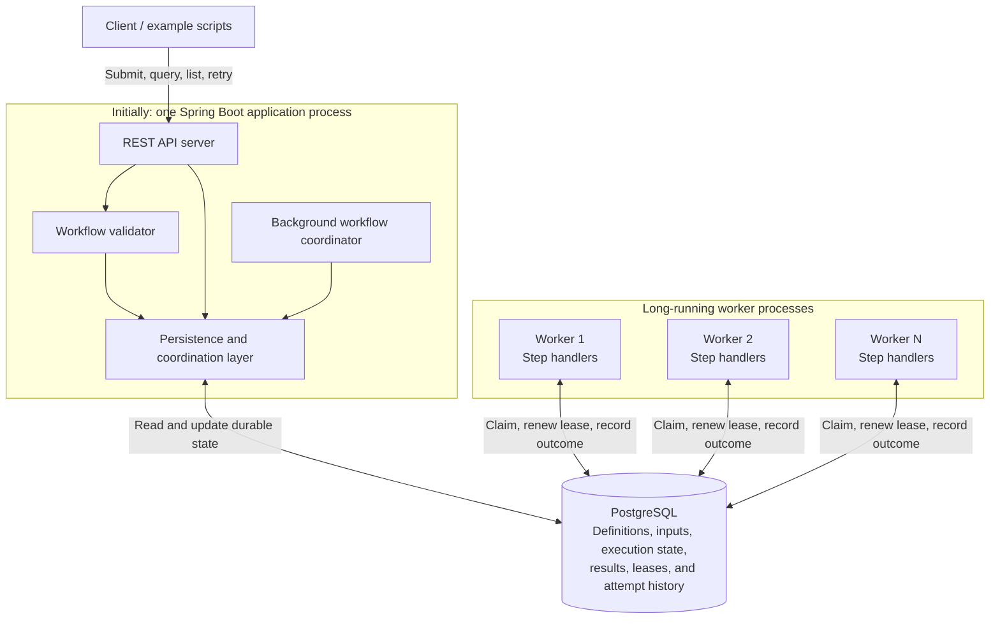
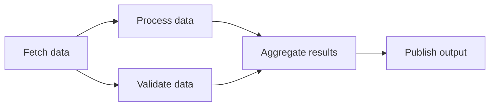
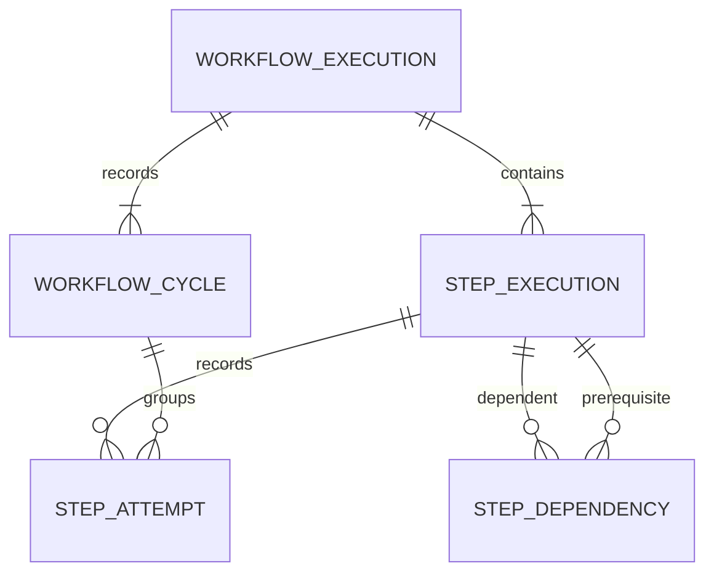
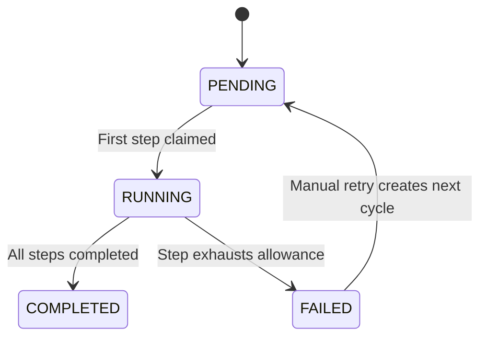
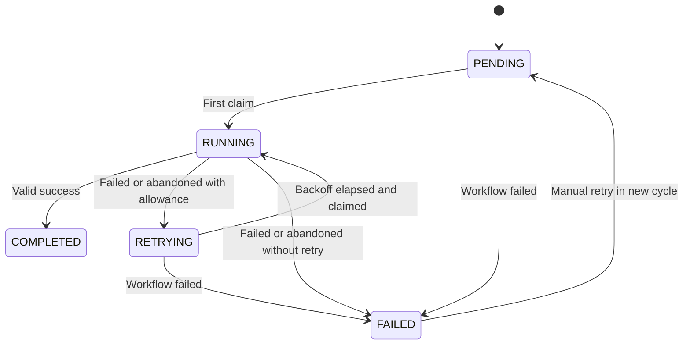
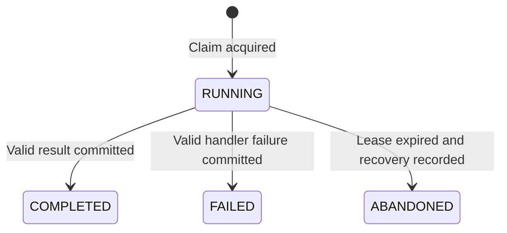

# Distributed Workflow Engine Design

## Status and scope

This document records the agreed architecture, persistence schema, execution lifecycle, and their rationale. It describes the intended system, not an implemented or verified system. Remaining details listed under **Open design decisions** still need agreement before their implementation.

The initial implementation targets the must-have requirements in [PROJECT_DESCRIPTION.md](PROJECT_DESCRIPTION.md) and follows [AGENTS.md](AGENTS.md). Scalability influences component boundaries and concurrency guarantees from the start, while additional infrastructure and optimizations remain future work. `PROJECT_CONTEXT.md` was referenced in the project instructions but was not present on disk when this document was created.

## Goals

- Execute DAG workflows with sequential dependencies, concurrent independent branches, and joins.
- Preserve definitions, inputs, progress, results, and attempt history across restarts.
- Coordinate multiple workers with atomic claims, leases, and fencing.
- Recover abandoned attempts, enforce retry limits and backoff, and support manual retry.
- Expose submission, listing, status, history, and retry APIs.
- Keep the implementation understandable and reproducible with Java, Maven, Spring Boot, PostgreSQL, and Docker Compose.
- Allow API, coordinator, and worker capacity to grow independently without changing the workflow execution model.

## Architecture

PostgreSQL is the authoritative store for execution state and also acts as the durable work queue. Workers pull eligible work from the database. A background coordinator advances workflows by evaluating persisted state; it does not execute business steps.

These boxes are logical responsibilities, not a requirement for separate services. The outer application box initially contains both the REST API server and the continuously running coordinator. The REST API box itself represents request handling only. Workflow execution continues independently of the HTTP request that submitted it.

### Components

| Component | Responsibility |
| --- | --- |
| REST API server | Accept submissions and expose workflow listing, workflow and step status, execution history, and manual retry. Delegate validation and execution decisions to the corresponding application components. |
| Workflow validator | Reject invalid definitions before execution, including empty DAGs, duplicate step IDs, unknown dependencies, cycles, unsupported action types, and invalid retry settings or input structure. |
| Workflow coordinator | Periodically inspect persisted execution state; make dependency-ready steps eligible; schedule retries; recover expired attempts; determine workflow completion or failure. |
| Worker runtime | Claim eligible steps atomically, invoke handlers, renew leases, and persist outcomes. Use bounded execution concurrency so work does not grow without limit inside a worker. |
| Step handlers | Implement supported Java business actions. Receive workflow inputs, step parameters, and completed dependency outputs; return results or report failures. Do not own orchestration or task-claim logic. |
| Persistence and coordination layer | Provide shared database operations and transactional rules for submission, eligibility, ownership, lease renewal, results, retries, history, and workflow finalization. Both the application and worker runtimes use this code. |
| PostgreSQL | Persist workflow definitions and inputs, workflow and step states, results, attempt history, retry schedules, and ownership information. Coordinate competing processes through atomic database operations. |

### Initial deployment

- One Maven project with shared domain, persistence, and handler code, separated by responsibility.
- One Spring Boot process running the API and coordinator together.
- Multiple long-running worker processes using the same project with a worker runtime profile. Workers are reused across steps; containers are not created per step.
- One PostgreSQL instance with persistent storage.
- Docker Compose starts the application, workers, and database.

Runtime roles should remain separable so that API-only and coordinator-only deployments can be introduced later. Separate repositories or independently developed microservices are unnecessary initially.

## End-to-end flow

1. **Submit and validate.** A client sends a nonempty DAG definition and workflow inputs. The application validates the definition, then atomically persists the definition snapshot, execution, initial cycle, steps, and dependencies. It returns an execution ID after persistence succeeds, without waiting for business execution.
2. **Find eligible work.** The coordinator examines active workflows. Root steps have no dependencies; other steps become eligible only after all dependencies complete successfully. The step's `eligible_at` records the earliest claim time, including backoff for retries.
3. **Claim a step.** An available worker atomically claims an eligible step and records its attempt, owner, lease expiration, and fencing token. The transaction must also ensure the workflow still permits execution. Competing workers cannot obtain the same valid claim.
4. **Execute the handler.** The worker invokes the selected Java handler outside the database transaction and renews its lease while execution continues. Business execution must not hold a database transaction open for the duration of a step.
5. **Persist the outcome.** The worker records success and output, or failure and error details, only while its fencing token and lease remain valid. The attempt outcome and corresponding execution-state change must be recorded consistently.
6. **Advance, retry, or fail.** Successful dependencies allow downstream work to become eligible. Failed or abandoned attempts are retried after backoff when allowance remains and the workflow is active. A step that exhausts its allowance fails the workflow and current cycle. Waiting steps are marked failed; already-running attempts may finish without further automatic retries.
7. **Complete, inspect, or manually retry.** The workflow becomes `COMPLETED` only when all required steps complete successfully. Clients can query persisted progress and history during execution and after restarts. Manual retry resumes a failed execution in a new cycle after all running attempts have settled, reusing completed outputs and granting unfinished steps fresh attempt allowances.

### Example DAG

Processing and validation can run concurrently on separate workers. Aggregation waits for both to complete successfully.

## Persistence model

### Definitions, executions, cycles, and attempts

- A **definition** describes the DAG, actions, parameters, and retry settings.
- An **execution** is one submission of that definition and workflow inputs. It has its own execution ID, state, and results.
- A **cycle** is the initial execution cycle or a subsequent manual retry within the same execution. It scopes attempt allowances and retains workflow-level outcomes.
- An **attempt** is one successfully claimed execution of one step by a worker. Automatic retries create attempts within the current cycle.

The definition is stored as an immutable JSON snapshot on the execution; there is no separate definition table or definition-management API initially. A snapshot is the saved configuration submitted for that execution, not a separate workflow object. Submission also creates normalized step and dependency records for scheduling. Write both representations in one transaction; action configuration and dependencies remain immutable afterward. The snapshot is the audit record, while the normalized records drive execution.

Submitting the same definition again creates a new execution and reruns all steps, potentially with different inputs. Manual retry keeps the existing execution ID, definition, and inputs; it reuses completed outputs and starts another cycle for unfinished work. The snapshot freezes configuration, not deployed Java handler code; exact reproduction across software upgrades would require additional versioning.

### Schema conventions

The following is the target schema for implementation, not an applied migration. Columns are required unless marked nullable. Timestamps use PostgreSQL `TIMESTAMPTZ`, structured payloads use `JSONB`, and statuses use `TEXT` with allowed-value check constraints. Payload shapes will be settled with the handler and API contracts. Creation and update timestamps use database time.

### `workflow_execution`

One row per submission. Definition and inputs remain unchanged across manual retries.

| Column | Type | Meaning |
| --- | --- | --- |
| `id` | UUID, primary key | Execution identifier. |
| `definition_json` | JSONB | Immutable submitted definition snapshot. |
| `inputs_json` | JSONB | Immutable workflow inputs. |
| `status` | TEXT | `PENDING`, `RUNNING`, `COMPLETED`, or `FAILED`. |
| `current_cycle_no` | INTEGER | Current cycle number, initially 1. |
| `created_at` | TIMESTAMPTZ | Submission time. |
| `first_started_at` | TIMESTAMPTZ, nullable | First successful step claim across all cycles; never reset. |
| `finished_at` | TIMESTAMPTZ, nullable | Current cycle's workflow completion or failure time; cleared on manual retry. |
| `updated_at` | TIMESTAMPTZ | Most recent workflow-state change. |

### `workflow_cycle`

Retains workflow-level outcomes when manual retry reopens an execution. For example, one execution may have cycle 1 failed, cycle 2 failed, and cycle 3 completed. The current execution status mirrors its current cycle; updates to both are transactional.

| Column | Type | Meaning |
| --- | --- | --- |
| `workflow_id` | UUID | Parent execution. |
| `cycle_no` | INTEGER | Initially 1; incremented on manual retry. |
| `status` | TEXT | `PENDING`, `RUNNING`, `COMPLETED`, or `FAILED`. |
| `created_at` | TIMESTAMPTZ | Submission or manual retry time. |
| `started_at` | TIMESTAMPTZ, nullable | First successful step claim in this cycle. |
| `finished_at` | TIMESTAMPTZ, nullable | Workflow completion or failure time for this cycle. |
| `failed_step_id` | TEXT, nullable | Step whose exhausted allowance caused this cycle to fail. |
| `error_code` | TEXT, nullable | Machine-readable failure reason. |
| `error_message` | TEXT, nullable | Failure explanation. |

**Primary key:** `(workflow_id, cycle_no)`. The cycle remains `FAILED` even if another already-running step subsequently succeeds. Its `finished_at` records workflow failure, not the time all outstanding handlers stop.

### `step_execution`

One row per DAG node, holding current state and ownership. Successful outputs are retained when the execution is manually retried.

| Column | Type | Meaning |
| --- | --- | --- |
| `workflow_id` | UUID | Parent execution. |
| `step_id` | TEXT | Step identifier from the definition. |
| `action_type` | TEXT | Java handler to invoke. |
| `parameters_json` | JSONB | Immutable step parameters. |
| `max_attempts` | INTEGER | Allowed attempts per cycle, including the first claim. |
| `backoff_initial_ms` | BIGINT | Initial retry delay. |
| `backoff_max_ms` | BIGINT | Maximum retry delay. |
| `status` | TEXT | `PENDING`, `RUNNING`, `COMPLETED`, `FAILED`, or `RETRYING`. |
| `eligible_at` | TIMESTAMPTZ, nullable | Earliest claim time; null means not eligible. |
| `last_attempt_no` | BIGINT | Lifetime attempt counter and fencing token; initially 0 and never reset. |
| `worker_id` | TEXT, nullable | Current claim owner. |
| `lease_expires_at` | TIMESTAMPTZ, nullable | Current ownership expiration. |
| `output_json` | JSONB, nullable | Successful output. |
| `error_code` | TEXT, nullable | Latest failure or workflow-blocking reason. |
| `error_message` | TEXT, nullable | Explanation of that reason. |
| `created_at` | TIMESTAMPTZ | Step creation time. |
| `updated_at` | TIMESTAMPTZ | Most recent step-state change. |

**Primary key:** `(workflow_id, step_id)`. A step is uniquely identified within its execution; a separate generated step ID is unnecessary. Ownership lives on this current-state row, while attempt rows preserve historical worker identities and outcomes.

### `step_dependency`

One row per DAG edge.

| Column | Type | Meaning |
| --- | --- | --- |
| `workflow_id` | UUID | Execution containing both steps. |
| `step_id` | TEXT | Dependent step. |
| `depends_on_step_id` | TEXT | Prerequisite step. |

**Primary key:** `(workflow_id, step_id, depends_on_step_id)`. Both step references use composite foreign keys into `step_execution`, preventing cross-execution dependencies. Reject self-dependencies in the database and validate longer cycles before persistence.

### `step_attempt`

One row per successful claim, including claims abandoned after lease expiry. An unexecuted step failed because its workflow failed has no fabricated attempt.

| Column | Type | Meaning |
| --- | --- | --- |
| `workflow_id` | UUID | Parent execution. |
| `step_id` | TEXT | Executed step. |
| `attempt_no` | BIGINT | Lifetime attempt number, also used as its fencing token. |
| `cycle_no` | INTEGER | Cycle in which the attempt was claimed. |
| `worker_id` | TEXT | Worker that acquired the claim. |
| `status` | TEXT | `RUNNING`, `COMPLETED`, `FAILED`, or `ABANDONED`. |
| `started_at` | TIMESTAMPTZ | Claim acquisition time. |
| `finished_at` | TIMESTAMPTZ, nullable | Time the terminal outcome was recorded. |
| `result_json` | JSONB, nullable | Successful attempt result. |
| `error_code` | TEXT, nullable | Failure or abandonment reason. |
| `error_message` | TEXT, nullable | Error details. |

**Primary key:** `(workflow_id, step_id, attempt_no)`. Foreign keys reference the step and cycle within the same execution. On claim, increment `step_execution.last_attempt_no` and copy it to the attempt in the same transaction. Recording success writes the attempt result and current step output together. Terminal attempts are immutable; manual retry creates new attempts rather than rewriting history.

### Constraints and indexes

- All execution, cycle, and step relationships use foreign keys. `workflow_cycle.failed_step_id`, when present, references a step within that execution.
- The execution's `(id, current_cycle_no)` references `workflow_cycle` through a deferred foreign key, allowing initial execution and cycle creation in one transaction despite their mutual references.
- Cycle and attempt numbers are positive; `last_attempt_no` starts at 0. Require `max_attempts >= 1`, positive backoff values, and `backoff_max_ms >= backoff_initial_ms`.
- A step has both `worker_id` and `lease_expires_at` exactly when its state is `RUNNING`. Clear both when the attempt becomes terminal.
- A non-null `eligible_at` is permitted only for `PENDING` or `RETRYING` steps. Clear it on claim or terminal failure.
- Attempts, cycles, and the current workflow have a non-null `finished_at` exactly when their respective state is terminal.
- A unique partial index on `(workflow_id, step_id)` where attempt status is `RUNNING` prevents two unfinished attempt records for the same step. Recovery must close an expired attempt before another claim is created.
- Dependency satisfaction and agreement between current-state and history rows require transactional operations; they cannot be expressed as ordinary row-level check constraints.

| Access pattern | Index beyond primary keys |
| --- | --- |
| Workflow listing | `workflow_execution(created_at, id)` |
| Active workflow discovery | Partial index on `workflow_execution(id)` for `PENDING` and `RUNNING` workflows. |
| Claimable work | Partial index on `step_execution(eligible_at, workflow_id, step_id)` for `PENDING`/`RETRYING` rows with non-null eligibility. |
| Expired leases | Partial index on `step_execution(lease_expires_at, workflow_id, step_id)` for `RUNNING` rows. |
| Find downstream steps | `step_dependency(workflow_id, depends_on_step_id, step_id)` |
| Per-cycle history and attempt counting | `step_attempt(workflow_id, cycle_no, step_id, attempt_no)` |

There is no worker registry table initially. Step leases provide the ownership information needed for recovery; worker membership tracking is not required for claiming work.

## Execution lifecycle

### Workflow and cycle transitions

The diagram describes the execution's current status. An individual cycle never reopens after reaching `FAILED` or `COMPLETED`; manual retry creates another cycle.

| Transition | Trigger and required effect |
| --- | --- |
| Creation in `PENDING` | Persist a validated nonempty DAG, inputs, initial cycle, steps, and dependencies atomically. Invalid submissions do not create an execution. |
| `PENDING -> RUNNING` | First successful claim in the current cycle; set that cycle's `started_at` and set execution `first_started_at` only if absent. |
| `RUNNING -> COMPLETED` | All steps are `COMPLETED`; finalize execution and current cycle together. |
| `RUNNING -> FAILED` | A step exhausts its allowance; fail execution and current cycle, retain the triggering failure, and fail all waiting steps together. |
| `FAILED -> PENDING` | Manual retry after running attempts settle; create the next cycle, reset failed steps, and clear execution `finished_at`. |

There are no new claims for a `FAILED` or `COMPLETED` workflow. Late step completion cannot reverse a workflow's terminal outcome. Starting a full new run requires a new submission rather than reopening a completed execution.

### Step transitions

| Transition | Meaning |
| --- | --- |
| `PENDING -> RUNNING` | Dependencies are complete, eligibility has arrived, and an atomic claim succeeds. |
| `RUNNING -> COMPLETED` | The current worker records success while its claim and lease are valid; clear current step error fields and retain errors in attempt history. This remains allowed after another step has failed the workflow. |
| `RUNNING -> RETRYING` | The attempt fails or is abandoned, allowance remains, and the workflow is still active. Persist the next eligibility time. |
| `RETRYING -> RUNNING` | Backoff has elapsed and a new valid claim is acquired. |
| `RUNNING -> FAILED` | No attempt allowance remains, or the attempt fails/is abandoned after the workflow has already failed. |
| `PENDING/RETRYING -> FAILED` | Workflow failure blocks further execution. Record `WORKFLOW_FAILED` without inventing an attempt. |
| `FAILED -> PENDING` | Manual retry starts a new cycle; clear current error details and eligibility, retaining earlier history and the lifetime fencing counter. |

Completed steps are not reset by manual retry. Their outputs remain available to dependencies. A step marked `FAILED` with `WORKFLOW_FAILED` may never have executed, or may have been waiting for another attempt; its attempt history distinguishes these cases.

### Attempt transitions

`FAILED` means the worker reported an execution failure. `ABANDONED` means the engine lost valid ownership without recording an outcome, such as after a crash or connectivity failure; it does not assert that the handler stopped running. Once terminal, an attempt cannot accept a late result or renew ownership. Attempt finalization and the corresponding step transition occur in one transaction.

### Eligibility and retry allowances

`eligible_at` separates scheduling eligibility from public step status:

- A newly created step is `PENDING` with null eligibility. The coordinator sets eligibility after all dependencies complete; root steps have no dependency barrier.
- A `RETRYING` step has an eligibility time representing the end of its backoff.
- An eligible step whose time has arrived may still be waiting for worker capacity.
- Claiming requires `PENDING` or `RETRYING`, arrived eligibility, and an active workflow, checked atomically against database time. No additional public `READY` state is needed.

The persistence design uses `max_attempts`, including the initial attempt, to avoid ambiguity between attempts and retries. Every successfully claimed attempt counts against its step's allowance in that cycle, including attempts later abandoned. Unclaimed work does not consume allowance. Count attempts by step and cycle while protecting the claim transaction from concurrent updates.

Use capped exponential backoff with multiplier 2. After the nth unsuccessful attempt in the current cycle, delay the next attempt by `min(backoff_max_ms, backoff_initial_ms * 2^(n - 1))`, calculated without arithmetic overflow. Persist the effective limit and backoff values on the step. API defaults, lease/heartbeat timings, and handler-specific non-retryable failures remain open; no additional failure classification is assumed yet.

### Workflow failure and manual retry

When a step exhausts its allowance, atomically fail the workflow and current cycle and mark all `PENDING`/`RETRYING` steps `FAILED` with `WORKFLOW_FAILED`. Completed steps and their outputs remain intact. Already-running attempts may renew valid leases and record their actual outcomes, but receive no further automatic retries. Their success does not reopen the workflow or make downstream work eligible.

Recovery must continue examining running leases even for failed workflows. An expired attempt becomes `ABANDONED`; its step becomes `FAILED` without another automatic attempt. Marking a step failed does not cancel external actions, and no rollback is implied.

Manual retry is permitted only for a failed execution with no remaining `RUNNING` attempts. Expired attempts must be recovered before retry is accepted. A still-valid attempt blocks retry even if the workflow is already failed. In one transaction:

1. Verify the failed status and absence of unfinished attempts.
2. Create the next `PENDING` cycle and update the execution's current-cycle reference and status; clear its `finished_at`.
3. Preserve completed steps and outputs. Reset failed steps to `PENDING`, clearing current errors and eligibility.
4. Leave definition, inputs, prior cycles, prior attempts, and lifetime attempt counters unchanged. The new cycle gives unfinished steps fresh attempt allowances.

For `A -> B -> C`, if A completed, B exhausted its allowance, and C never ran, manual retry reuses A's output, retries B, then executes C. A full new submission executes all three again. Completed work is reused without checking external freshness; use a new execution if inputs, definition, or all business effects must be refreshed.

Settled attempts do not guarantee all stale external code has stopped. Idempotency remains necessary even after manual retry passes its ownership checks.

## State and reliability guarantees

Workflow, step, and attempt states follow the lifecycle above. Each attempt and workflow cycle retains its own durable history, so automatic and manual retries do not overwrite earlier outcomes. Current step rows are mutable summaries; this schema does not promise a separate audit event for every intermediate step-state change.

### Ownership and concurrency

- Only one worker may hold a valid claim for a step at a time.
- Claims, renewals, and outcome updates use atomic database checks rather than process-local locks.
- Database time determines lease validity, avoiding reliance on agreement between worker clocks.
- Fencing tokens distinguish successive ownership attempts. An expired or superseded attempt cannot renew ownership or overwrite current execution state.
- Dependency promotion, retry scheduling, recovery, and finalization must remain correct when multiple coordinators act concurrently. Starting with one coordinator must not make singleton execution a correctness requirement.
- Essential progress and ownership are stored in PostgreSQL; in-memory state is only temporary execution state or an optimization.
- Scheduling decisions, claims, attempt finalization/recovery, and manual retry acquire the parent workflow row before affected step rows, locking multiple steps in step-ID order. This serializes short decision transactions within one workflow, not handler execution; independent steps still execute concurrently and different workflows can advance independently.
- Lease renewals use conditional updates on the current step's state, owner, fencing token, and unexpired lease. They remain allowed for valid running attempts after workflow failure and do not require holding a workflow lock during handler execution.
- Workflow failure and claims must use the same transaction ordering so a step cannot be newly claimed after failure commits. Detailed SQL and race-case verification remain implementation-design work.

### Failure behavior and consistency trade-offs

| Situation | Intended behavior and limitation |
| --- | --- |
| Worker crashes | Its lease expires. The coordinator records the attempt as abandoned, then retries only if the workflow is active and allowance remains. A replacement worker may execute the step again. |
| Worker loses database connectivity | It cannot renew ownership or commit an outcome. After lease expiry, stale state writes are rejected. An already-running external action may still finish. |
| Coordinator process stops | Persisted progress remains. Coordinator-driven advancement and recovery pause until a coordinator resumes; already-running handlers may continue while their ownership remains valid. |
| API process stops | Clients temporarily lose API access. In the initial combined process, the coordinator also stops. Independent workers and the database retain their own lifecycle. |
| PostgreSQL is unavailable | New submissions, claims, renewals, and durable state changes cannot succeed. Progress requiring those operations pauses until connectivity returns. |
| Handler succeeds externally but its result is not durably recorded | The engine may retry the step and repeat its external effects. |
| A step exhausts retries | The workflow and current cycle fail. Waiting steps fail with `WORKFLOW_FAILED`. Running attempts may finish without automatic retries; manual retry waits for them to finish or be recovered after lease expiry. |

The design favors consistent execution ownership and state over continued scheduling during database partitions. A local PostgreSQL volume preserves data across container restarts; a single database instance does not provide database high availability or protection against disk loss.

### Execution semantics

Execution is **at least once**, subject to configured retry limits. Leases and fencing protect engine state; they do not guarantee exactly-once effects in external systems or prevent all overlap between stale and replacement handler code.

Handlers should use idempotent operations or stable external idempotency keys where possible. The handler contract must document these assumptions. Cancellation of external work and compensation are outside the initial scope. Lease-based crash recovery is required even though user-configurable execution timeouts are optional.

## Design choices and rationale

The following records the choices agreed in discussion and the alternatives they avoid. Alternatives are architectural comparisons, not claims that prototypes or benchmarks have been performed.

| Choice | Reason | Alternative and trade-off |
| --- | --- | --- |
| Use PostgreSQL for both durable state and task discovery initially | Keeps ownership, results, and workflow transitions close to one transactional source of truth while minimizing infrastructure for the assignment. | A separate broker can improve task delivery characteristics at scale, but adds delivery/acknowledgment behavior and database-to-broker consistency concerns. Revisit only when measured needs justify it. |
| Combine API and coordinator in one initial process, with separate logical components | Reduces deployment complexity while preserving clear responsibilities and an independent background execution loop. | Separate services allow independent scaling and failure isolation immediately, but increase initial operational work. Preserve runtime-role boundaries so separation is possible later. |
| Run business logic in independent, long-running workers | Worker capacity can scale independently of request handling and orchestration, without per-step process startup. | Executing handlers inside request handling ties execution to API lifecycle and capacity. Creating containers per step adds orchestration overhead outside the must-have scope. |
| Pull work from PostgreSQL using atomic claims | Provides a simple durable handoff and safe competition among multiple workers. | Direct in-memory dispatch would need additional durable handoff and recovery mechanisms. Polling introduces database load and scheduling latency that must be measured and tuned. |
| Use leases plus fencing | Leases allow recovery after worker loss; fencing prevents stale attempts from corrupting newer state. This is also required by AGENTS.md. | A permanent owner can strand work after a crash. A lease without fenced writes leaves stale-result races. Neither approach guarantees exactly-once external effects. |
| Design concurrency-safe coordinator operations from the start | Allows future coordinator replication without changing fundamental state-transition rules. | Relying on a single process or local locks initially would embed assumptions that become unsafe with multiple coordinators. Actual multi-coordinator deployment remains future work. |
| Store the definition snapshot on each execution; defer a separate definition table | Each submission already supplies its definition and inputs. Keeping them together avoids a separate definition identity, lifecycle, and management API while preserving submitted configuration. | A reusable definition/version table is useful when many executions reference a saved definition, particularly for recurring schedules. Revisit then; retain per-execution snapshots so later definition changes cannot alter existing runs. |
| Materialize steps and dependencies alongside the snapshot | Scheduling can query indexed relational records without repeatedly parsing the full definition. Same-execution foreign keys enforce dependency integrity. | Keeping only JSON would simplify submission storage but complicate task claims, dependency queries, and concurrent step updates. Maintaining both representations requires atomic creation and immutable configuration. |
| Separate step state, attempt history, and workflow cycles | Current-state reads stay straightforward; every worker attempt and manual-retry outcome remains visible. Cycles scope fresh attempt allowances without resetting fencing tokens. | Overwriting current rows alone loses history. A linked new execution for each manual retry is possible but was declined in favor of resuming the same execution ID and completed outputs. |
| Represent readiness with `eligible_at` | Distinguishes dependency waiting, retry backoff, and available work without expanding the required public step states. | A separate `READY` state would add transitions while still needing a timestamp for backoff. Claims must check eligibility and workflow status atomically either way. |
| Fail waiting work and let active attempts finish after workflow failure | Stops new execution while retaining truthful outcomes and avoiding cancellation machinery. `WORKFLOW_FAILED` distinguishes blocked work from handler failure. | Immediately failing and fencing active attempts rejects potentially useful results without reliably stopping external effects. The chosen policy can delay manual retry while a healthy attempt continues to hold its lease. |
| Resume manual retry in a new cycle, preserving completed outputs | Avoids repeating successful work, keeps one execution identity, and preserves prior failures and attempt allowances. | Starting over is available through a new submission. Reusing outputs assumes their continued validity; refreshing inputs or all effects requires a new execution. |
| Count abandoned claims toward a cycle's attempt limit | Gives crashes and repeated connectivity failures a bounded recovery policy. A successful claim, rather than a reported handler result, defines an attempt. | Excluding abandoned claims could retry indefinitely. This choice can exhaust allowance without a confirmed business failure; history exposes that distinction. |
| Use short workflow-row locks for state-changing scheduling transactions | Provides an understandable ordering for claims, failure, completion, and manual retry, including future competing coordinators. | More granular coordination may improve large-workflow scheduling throughput but complicates terminal-state races. Locks do not span business execution; revisit granularity only if measured contention warrants it. |
| Keep the first release focused on must-have behavior | Correct execution, recovery, and reproducible verification take priority within the assignment's time constraints. | Additional infrastructure, dashboards, and advanced workflow features increase scope before the execution model is verified. |

As detailed decisions are made, extend this record with the selected behavior, reasons, alternatives considered, and consequences. Keep proposals and unresolved questions distinct from agreed decisions.

## Scalability and future improvements

| Area | Initial implementation | Future improvement and reason to revisit |
| --- | --- | --- |
| API capacity | One API instance; no essential execution state kept in API memory. | Deploy stateless API instances behind a load balancer when request volume or availability requires it. |
| Coordinator capacity | One coordinator using concurrency-safe state transitions. | Run multiple coordinators; later partition responsibility by workflow if scans or lock contention limit throughput. Concurrent coordinators must be tested before claiming support. |
| Worker capacity | Multiple workers, bounded concurrency, and claims limited to available execution capacity. | Add workers independently; consider action-specific worker pools when workloads need different resources. Adding workers is limited by database and downstream capacity. |
| Database workload | PostgreSQL-backed task discovery with indexes supporting eligibility, retry, and lease queries. | Measure query load and contention; tune polling, batching, and connection budgets before introducing new infrastructure. Avoid claiming more work than workers can execute. |
| History and results | Store results and attempt history durably in PostgreSQL. | Introduce pagination, retention/archival policies, and potentially external storage for large outputs as data volume warrants. |
| Availability | One application/coordinator process and one database instance. | Separate application roles and introduce database high availability and backup/recovery procedures when deployment requirements justify them. |
| Task delivery | Database polling without a broker. | Consider notifications or a broker if measured discovery latency or polling load becomes unacceptable. Any change must preserve durable handoff and claim/fencing guarantees. |
| Reusable definitions and recurring execution | Immutable definition JSON on each submitted execution; no separate definition or schedule table. | Add reusable definitions/versions and schedule records when recurring execution is introduced. Each scheduled occurrence creates an execution with its own snapshot and inputs. Separate definitions are useful for reuse, though recurring execution does not strictly require them. |

Prioritize future work by observed constraints: first measure scheduling latency, query load, lock contention, and worker utilization; then tune database access and worker capacity; then separate or replicate runtime roles. Introduce partitioning, new storage, or a broker only when simpler changes are insufficient. Database durability and availability requirements may independently justify earlier operational improvements.

PostgreSQL remains a shared throughput and availability dependency. More workers do not provide unlimited scaling, and separating runtime roles does not remove this bottleneck.

Optional product capabilities remain deferred: cancellation, compensation, workflow versioning, conditional execution, recurring schedules, user-configurable execution timeouts, an administrative UI, and advanced metrics/tracing. Basic diagnostic logs and useful errors are part of the initial implementation.

## Open design decisions

Before implementing the affected behavior, settle and record:

1. The Java handler contract, input/output representation, dependency-output access, and error classification, including whether some failures are non-retryable.
2. Detailed SQL for claim, renewal, fencing, dependency promotion, failure, completion, recovery, and manual retry; verify the specified lock ordering and transaction rules against races.
3. Lease duration, heartbeat and polling intervals, worker capacity configuration, and worker behavior after renewal failures.
4. API defaults for attempt limits and initial/maximum backoff delays. Attempt counting, capped exponential backoff, fresh per-cycle allowances, and treatment of abandoned attempts are settled above.
5. API routes, payloads, error responses, and listing/history pagination, including how clients inspect cycles and distinguish failed workflows with still-running attempts.

## Verification plan

The implementation must demonstrate sequential execution, concurrent branches, joins, worker competition, lease expiry and crash recovery, rejection of stale writes, connectivity failure handling, retry limits and backoff, manual retry, and persistence across application and database restarts. Tests must also cover invalid DAGs, schema constraints, and terminal-state races.

Specific persistence and lifecycle scenarios include:

- Reject empty DAGs, unknown dependencies, cycles, duplicate edges, and cross-execution step references.
- Atomically create execution, initial cycle, definition snapshot, steps, and dependencies; roll back all records on failure.
- Permit only one current claim/unfinished attempt per step and reject expired or superseded renewals/results, including results arriving after abandonment.
- Count abandoned attempts toward the current cycle's limit and respect persisted retry eligibility and backoff.
- Race workflow failure with claims and other step completions; no claims succeed after failure commits, waiting steps fail without fabricated attempts, and late success never reopens the workflow.
- Allow valid attempts to renew and finish after workflow failure, and recover expired attempts on failed workflows without retrying them.
- Reject manual retry while valid running attempts remain. Race simultaneous manual retries so only one next cycle is created.
- Preserve completed outputs, definition, inputs, earlier cycles, and attempt history across manual retry; grant fresh allowances while keeping fencing tokens monotonically increasing.
- Keep execution and current-cycle status consistent, distinguish blocked steps from executed failures, and complete only after all steps succeed.

Run focused tests during implementation and the full Maven suite at milestone boundaries. Verify Docker Compose startup and sample workflows from a fresh clone. These are planned checks, not results already achieved. Multi-coordinator operation and additional infrastructure require their own verification before being presented as supported.

This document records architecture, persistence, and lifecycle decisions only. It does not complete the remaining detailed design or authorize the next implementation milestone.
