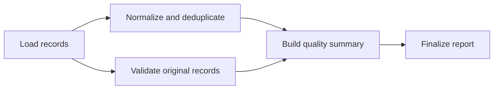

# Provider Records Validation Demo

## Status and purpose

The agreed demo is implemented and locally verified on 2026-10-19. This document is the milestone's central record for the design, deliverables, operating instructions, and verification evidence.

The goal is to demonstrate a realistic application consuming the distributed workflow engine (DWE): process synthetic healthcare-provider directory records, explain data-quality problems, and export a report and cleaned dataset. The successful workflow and separate retry/crash demonstrations must produce equivalent business results.

## Run the demo

From the repository root, rebuild/start the application so the new registered handlers are available:

```sh
docker compose up --build -d --wait
python3 demo/provider-quality/client.py
```

If your local stack uses monitoring, retain both Compose files when rebuilding instead:

```sh
docker compose -f docker-compose.yml -f compose.observability.yml up --build -d --wait
python3 demo/provider-quality/client.py
```

The default client submits [normal.json](demo/provider-quality/normal.json) to `http://localhost:8080`. It prints the execution ID, status changes, summary counts, and findings. It exports local files under `provider-output/<execution-id>/`:

- `report.json`: schema version, summary, ordered findings, and source provenance.
- `cleaned-providers.json`: the normalized, deduplicated records, in retained source order.

Use a different API URL or directory as needed:

```sh
python3 demo/provider-quality/client.py --api-url http://localhost:8080 --output-dir /tmp/provider-demo
```

The client refuses to overwrite existing files. Use a fresh directory or explicitly pass `--overwrite`. To retrieve an existing execution without submitting another workflow:

```sh
python3 demo/provider-quality/client.py --execution-id YOUR_EXECUTION_ID --output-dir /tmp/provider-reexport
```

`--input` selects another submission file; it is mutually exclusive with `--execution-id`. `--timeout` defaults to a 180-second workflow wait, `--request-timeout` to 10 seconds per HTTP request, and `--poll-interval` to one second. A completed workflow's final-output read has its own request budget. Client timeout does not cancel the workflow; retain its execution ID for later inspection/export. A network error stops the client with a nonzero exit code rather than automatically replaying submission.

For the transient-failure variant against the running stack:

```sh
python3 demo/provider-quality/client.py --input demo/provider-quality/retry.json
```

For an isolated walkthrough including actual worker death:

```sh
python3 scripts/verify-provider-demo.py
python3 scripts/verify-provider-demo.py --observability --keep
```

Each command creates a separate temporary Compose project; the second additionally provisions the existing monitoring stack and retains its successful result. Open the **printed** dashboard URL and use a time range covering the walkthrough. The script prints API/dashboard URLs, artifact/configuration paths, and a project-specific cleanup command. Follow that command when finished; then remove the printed temporary image/directory as desired. `--keep` retains exports plus API attempt histories under `exports/`; the default cleans its project, volumes, image, and temporary files. The normal local stack is untouched.

`--mode normal`, `--mode retry`, or `--mode crash` selects a focused walkthrough. A normal execution always runs first as the business-result baseline. The default `--mode all` runs all three. [crash.json](demo/provider-quality/crash.json) supplies the deliberate delay to this harness; submitting that file alone simply delays the first validation attempt and does not kill a worker.

## Application boundary

- Add business handlers through the existing `StepHandler` contract and Spring handler registration.
- Keep the engine, worker runtime, API server, persistence/schema, and observability unchanged unless a separately identified bug requires a fix.
- Use the existing submission, execution, step-output, and attempt-history APIs. Add no provider-specific API or report endpoint.
- Present and export results in a standalone Python client that communicates with DWE over HTTP. The client does not access PostgreSQL or import Java implementation details.
- Keep deliberate failure/container manipulation in separate demo tooling. The normal client uses public APIs only.
- Use synthetic records and local JSON artifacts; no healthcare-system integration, external validation service, PDF generation, or new frontend is required.

Handlers return JSON objects. DWE already persists these outputs. The final handler does not write files or deliver reports to an external system; the client retrieves persisted output and writes local artifacts. Re-exporting an existing execution does not require another workflow submission.

## Scenario and sample data

The input represents five source rows from a provider directory:

| Source row | Provider ID | Name | Specialty | State | Email |
| --- | --- | --- | --- | --- | --- |
| 1 | P001 | Alice Smith | Cardiology | MA | alice@example.com |
| 2 | P002 | Bob Jones | Neurology | MA | bob@example.com |
| 3 | P003 | Carol Lee | Dermatology | NY | Missing |
| 4 | P004 | David Chen | Cardiology | XX | david@example.com |
| 5 | P002 | Bob Jones | Neurology | MA | bob@example.com |

The checked-in submission JSON will contain the DAG and records under workflow inputs. The external client reads that file; workers receive the persisted inputs through `StepContext` and need no shared filesystem.

Expected business results:

- Five input rows and four distinct nonblank provider IDs.
- Four cleaned records after removing the duplicate P002 row.
- One duplicate finding, one missing-email finding, and one invalid-state finding: three findings in total.
- The missing email and invalid state remain visible in the cleaned records; normalization/deduplication does not invent corrections.
- The workflow completes successfully despite these data-quality findings.

## Workflow and handler responsibilities



| Step ID | Handler responsibility | Output contract |
| --- | --- | --- |
| `load-records` | Check the input batch's structure and attach stable, one-based source-row references. | Original records with source-row references. |
| `normalize-records` | Normalize fields and remove identical duplicates. Preserve conflicting records. | Cleaned records, duplicate/conflict findings, and source-row provenance. |
| `validate-records` | Validate original rows using the documented field-normalization rules for comparisons. | Field findings identifying source row, provider ID when available, field, and rule/code. |
| `summarize-quality` | Combine the two branch outputs and calculate report counts. | Business report and cleaned records, with deterministic ordering. |
| `publish-report` | Finalize the output object for retrieval by the external client. | `report` and `cleanedRecords` JSON fields. |

The respective action types are `PROVIDER_LOAD`, `PROVIDER_NORMALIZE`, `PROVIDER_VALIDATE`, `PROVIDER_SUMMARIZE`, and `PROVIDER_FINALIZE`. Implementations live in [handler/demo/provider](src/main/java/com/athenahealth/dwe/handler/demo/provider). Dependency references are explicit handler parameters: `sourceStep` for the two branches, `normalizedStep`/`validatedStep` for the summary, and `summaryStep` for finalization. These references must name the corresponding direct dependencies; a missing output is a permanent handler input error. No business step IDs are embedded in orchestration code.

Both branches consume only the load step's output. Validation therefore describes the original rows even when normalization removes a duplicate. The summary waits for both branch outputs; finalization consumes the summary output. Each handler uses direct dependency outputs through the existing contract.

B and C are eligible to run concurrently. Their assignment to different worker processes is not guaranteed; one worker with multiple slots can execute both. Tests must establish dependency ordering and overlap explicitly rather than infer parallelism from a diagram or short elapsed time.

## Agreed business rules

### Validation and normalization

Required fields are `providerId`, `name`, `specialty`, `state`, and `email`. Missing, blank, or incorrectly typed business fields produce findings. State validation uses a fixed, documented allowlist of the 50 US states plus DC. Email validation checks a basic address shape; it does not perform delivery or mailbox verification. Specialty must be present but is not checked against an external taxonomy.

Normalization trims surrounding whitespace, uppercases state codes, and applies the same comparison rules in both branches. Provider IDs retain their case; names and specialties retain their spelling/case. Email normalization preserves the local part and lowercases its domain. The basic email rule requires a nonempty local part, exactly one `@`, and a dotted domain with nonempty labels, with no Unicode whitespace. It deliberately does not implement full RFC address parsing or domain/delivery verification.

An optional `active` boolean can be preserved as directory metadata; it is not required for the supplied five-row scenario. Source-row provenance is separate from provider business fields.

A malformed batch, such as a missing/non-array records value or a non-object record, is a permanent input error. A structurally valid record with bad business fields is an ordinary reportable result. This distinction keeps retry behavior tied to operational failures.

### Duplicate and conflict handling

- Remove records only when their normalized business content is identical. Preserve the first occurrence and record the removed source row and its retained counterpart.
- Records sharing a nonblank normalized provider ID but differing in content are retained and reported as conflicts. Never select one silently or merge conflicting values.
- Records without a usable provider ID remain in the dataset and receive validation findings; missing IDs do not form a shared duplicate group.
- Emit one duplicate finding per removed row. Emit field findings per source row and validation rule; do not emit both missing and invalid-format findings for the same absent value. Emit one conflict finding for each additional distinct normalized record sharing an ID, referencing the first retained source row for that ID. A duplicate of a conflicting variant is removed and references that variant's first source row; it does not add another conflict.
- Report input-row count, cleaned-row count, distinct-provider-ID count, duplicate count, validation-finding count, and conflict count separately. The number of findings need not equal the number of affected providers.

Validation considers all original rows. Consequently, duplicate source rows can each have field findings, even though only one record is retained in the cleaned dataset. Stable source references make this accounting inspectable.

### Determinism

Preserve source order for cleaned records and define a stable order for findings. Keep execution IDs, worker identities, attempt numbers, and timestamps out of the business-result comparison. Those details can be displayed or exported separately as execution metadata.

The handlers use no business side effects requiring external deduplication. Re-execution after a failed report or expired lease must calculate the same business content. Existing at-least-once execution and fencing semantics still apply.

## External client and result presentation

The client lives under `demo/provider-quality/` and uses the Python standard library. It supports a configurable API base URL, input file, output directory, and bounded polling/request timeouts.

Normal operation:

1. Read the sample submission and POST it to `/api/v1/executions`.
2. Print the execution ID and observable step/status changes while polling existing APIs.
3. On completion, GET `/api/v1/executions/{executionId}/steps/publish-report` and extract its persisted output.
4. Print the report counts and a readable findings table.
5. Export `report.json` and `cleaned-providers.json` locally; show their paths and the execution ID.

An existing-execution option will retrieve/export results without POSTing another submission. Failed executions and timeouts must be reported clearly, without presenting incomplete output as a successful report. If a submission response is lost, the client must not automatically submit again: the existing API has no durable submission idempotency key.

The external client owns artifact presentation; DWE remains responsible for durable execution and outputs. Existing export files are refused unless `--overwrite` is supplied. The default destination is `provider-output/<execution-id>/`, ignored by Git when run from the repository root. A local filesystem error can leave a partial export; use the existing execution ID to export again into a fresh directory or explicitly overwrite. Export is not a transactional external publication protocol.

## Separate fault demonstrations

The default workflow contains no intentional delay or failure. Demo-only controls in the validation handler are explicit, validated parameters and disabled by default. They must use durable attempt identity rather than process-local counters, cooperate with cancellation, and leave successful business output unchanged.

`demoFailFirstAttempt` is an optional boolean (default false). `demoFirstAttemptDelayMs` is an optional integer from 0 to 120000 (default zero). Both apply only to lifetime attempt 1; retry/replacement attempts and later manual-retry cycles do not repeat the fault. Delay checks ownership cancellation at most every 100ms between sleeps. The retry fixture uses a 1-second initial backoff, a 2-second cap, and three allowed attempts. The crash fixture delays the first attempt for 120 seconds, while the harness uses the engine's ordinary 30-second lease and 5-second recovery interval. This is fault setup, not a handler execution-timeout feature.

| Mode | Controlled fault | Evidence required |
| --- | --- | --- |
| Normal | None | Expected report and cleaned dataset; all steps complete. |
| Automatic retry | One deliberately simulated transient validation failure. | Validation history shows a failed attempt, persisted backoff, and a successful replacement; final business output matches normal mode. |
| Worker crash | A cancellable first-attempt delay allows the script to identify and kill the worker owning validation. | Lease expiry produces `ABANDONED`/`LEASE_EXPIRED`; another worker completes a higher attempt; downstream steps wait and the final business output matches normal mode. |

The crash harness uses a uniquely named Compose project, disposable ports/storage, and scoped cleanup. It must not kill workers in the user's normal stack. Fault setup, inspection, and cleanup belong outside DWE production components. The killed worker's restart behavior must be controlled so the replacement is performed by the surviving worker.

The existing monitoring overlay can visualize outcomes, retries, abandonment, capacity, and progress. No provider IDs or record values are added as metric labels. Expired-lease gauges may miss brief states between samples; attempt history establishes that expiry/recovery occurred.

## Delivered components

| Component | Location |
| --- | --- |
| Five business handlers and shared JSON rules | [handler/demo/provider](src/main/java/com/athenahealth/dwe/handler/demo/provider) |
| Standalone public-API client | [client.py](demo/provider-quality/client.py) |
| Normal/retry/crash submissions and expected counts | [demo/provider-quality](demo/provider-quality) |
| Isolated walkthrough and history assertions | [verify-provider-demo.py](scripts/verify-provider-demo.py) |
| Business-rule tests | [ProviderRecordsHandlerTest.java](src/test/java/com/athenahealth/dwe/handler/ProviderRecordsHandlerTest.java) |
| PostgreSQL and worker integration tests | [ProviderRecordsDemoIT.java](src/test/java/com/athenahealth/dwe/integration/ProviderRecordsDemoIT.java) |
| Client tests | [test_client.py](demo/provider-quality/test_client.py) |

## Output contract

The final step output has two fields: `report` and `cleanedRecords`. The report contains `schemaVersion: 1`, `summary`, `findings`, and `provenance`. For the supplied sample, the summary is:

```json
{
  "inputRecords": 5,
  "cleanedRecords": 4,
  "uniqueProviderIds": 4,
  "duplicatesRemoved": 1,
  "validationFindings": 2,
  "conflicts": 0,
  "totalFindings": 3
}
```

Findings carry `sourceRow`, `field`, `code`, and `message`; `providerId` and normalized `value` appear when available. Duplicate/conflict findings additionally carry `relatedSourceRow`. Findings are sorted by source row, then field, then code. Codes are `MISSING_FIELD`, `INVALID_FIELD_TYPE`, `INVALID_STATE`, `INVALID_EMAIL`, `DUPLICATE_RECORD`, and `CONFLICTING_PROVIDER_ID`.

Provenance maps one-based `cleanedRecordIndex` values to `sourceRows`, including removed duplicates: the retained P002 record maps to rows `[2, 5]`. Cleaned records contain the original business fields with the documented normalization; extra metadata is retained and participates in duplicate equality. `active` is preserved as supplied and has no additional validation rule in this demo.

## Acceptance and verification

- Handler tests cover normalization, missing/invalid fields, allowed states, basic email shape, identical duplicates, conflicting IDs, missing IDs, stable provenance/order, and cancellation/fault controls.
- PostgreSQL integration tests exercise the registered handlers, dependency-output flow, parallel branch/join behavior, persisted final results, and automatic retry without changes to orchestration.
- Client checks cover HTTP error/timeout handling, terminal failure, export content, and re-export of an existing execution without another submission.
- Container checks demonstrate the normal workflow, transient failure, actual worker death/replacement, and equivalent business outputs. Faults and cleanup remain isolated.
- Full Maven verification and relevant existing delivery checks continue to pass. Inspect the diff to confirm that core engine, worker, API, schema, and monitoring changes have not been introduced beyond an explicitly justified bug fix.

Reproduce the checks from the repository root with Java 21 and Docker available:

```sh
./mvnw clean verify
python3 -m unittest discover -s demo/provider-quality -v
python3 scripts/verify-provider-demo.py --observability
python3 scripts/verify-delivery.py
```

**Verification checkpoint (2026-10-19):** Clean Maven verification passed 94 unit tests and 117 PostgreSQL integration tests, with no failures, errors, or skips. These include 34 provider handler cases and four provider integration tests. All 12 standalone client tests passed. The final monitored container walkthrough passed normal report/cleaned-data export, re-export without resubmission, transient failure with persisted backoff, and actual worker death/lease abandonment/replacement with identical complete business outputs. The original delivery script passed examples, branch overlap/join ordering, retries, worker competition, API/worker/database restarts, and retained-volume recreation. Temporary verification stacks were cleaned up; the normal local stack was preserved.

The diff contains no changes to core engine/coordinator, worker runtime, persistence, API server, schema, monitoring, Maven dependencies, or Compose deployment. New production Java files are confined to the registered demo-handler package.

**Limits:** This is a small local demonstration, not a production directory-validation service or throughput benchmark. Email checking is intentionally basic; no external provider identity, specialty, or deliverability checks are performed. Entire batches and branch outputs are JSON in PostgreSQL, so large-batch streaming/storage concerns remain outside this milestone. Separate steps provide a visible extension-contract demonstration at the cost of repeated persisted JSON. Fault injection is explicit demo behavior; execution timeouts and external report-publication guarantees have not been added. Existing at-least-once business execution and best-effort monitoring limitations remain applicable.
