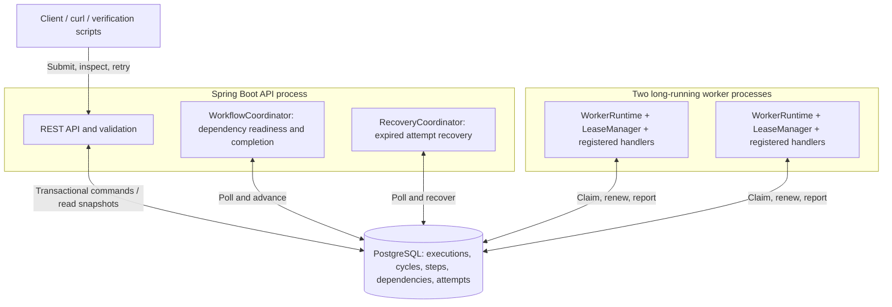
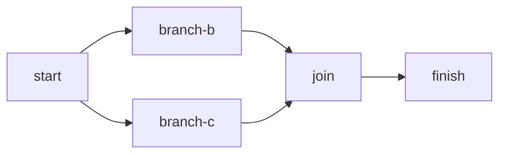

# Distributed Workflow Engine

A Java 21 / Spring Boot application with PostgreSQL-backed workflow state and leased worker claims. Maven builds a single artifact that runs as either an API/coordinator or a worker process. The approved architecture is in [DESIGN.md](DESIGN.md); the current milestone breakdown is in [Milestones.md](Milestones.md), with earlier planning and environment checks in [Plan.md](Plan.md).

## Implementation and delivery scope

This checkpoint implements validated submission, paginated execution listing, execution/step queries, cycle/attempt history, manual workflow retry, Flyway-managed storage, handler registration, conditional claims, lease renewal, fencing, durable outcome reporting, sequential/parallel DAG execution, and expired-attempt recovery. Compose starts two worker containers by default, each with two handler slots. `ECHO`, `DELAY`, and `FAIL_UNTIL_ATTEMPT` are predefined demonstration handlers. API and workers run in separate containers using the same image.

Recovery settles expired attempts as `ABANDONED` and schedules another attempt when the workflow is active and allowance remains. Expiry exhausting the allowance fails the workflow; expired siblings on already-failed workflows are settled without retry. Manual retry creates a fresh cycle after all attempts settle, preserving completed work and history. All agreed API routes are implemented. This is a local assignment deployment with the limitations described below; optional extensions are prioritized in Milestones.md.

## Architecture overview



The API and both coordinators share one process. Workers run separately and use PostgreSQL as both durable storage and the work queue. A shared Maven artifact supplies both runtime profiles. Handlers execute outside database transactions; short guarded transactions protect claims and lifecycle changes. Each worker has two execution slots by default. No external message broker or worker registry is required.

## Prerequisites and build

- Java 21 JDK and Docker Desktop (or a compatible Docker daemon) running.
- Maven Wrapper included; system Maven 3.9+ also works.
- Initial builds need internet access for Maven dependencies and container images.

On the validated macOS environment, select Java 21 explicitly because system Maven otherwise selects Java 26:

```sh
export JAVA_HOME=/Library/Java/JavaVirtualMachines/temurin-21.jdk/Contents/Home
./mvnw clean verify
```

Use the path to your own Java 21 installation on other machines. Maven Enforcer rejects unsupported Java versions. `verify` runs unit tests and PostgreSQL integration tests through Testcontainers; it fails if Docker is unavailable. `./mvnw test` runs unit tests only. The test database is disposable and separate from the Compose database. No host PostgreSQL installation is needed.

## Run with Docker Compose

From the repository root, the assignment startup command builds a missing image and starts the complete system in the foreground:

```sh
docker-compose up
```

Use a second terminal for the HTTP examples. For detached startup, or to rebuild after source changes:

```sh
docker-compose up --build -d --wait
docker-compose ps
```

`docker compose` is equivalent. The image uses pinned Java 21 JDK/JRE bases, a multi-stage Maven build, and a non-root runtime user. Unit/integration verification runs separately from the image build; its packaging stage skips test execution.

The API listens on `http://localhost:8080`; PostgreSQL is published on loopback port 5432. Defaults are suitable for local development. Optional overrides are shown in [.env.example](.env.example); copy it to `.env` if needed. `API_PORT` and `DB_PORT` change host ports. Compose applications always use PostgreSQL's internal port 5432.

```sh
curl --fail http://localhost:8080/actuator/health
curl --fail -i -H 'Content-Type: application/json' \
  --data-binary @examples/sequential.json http://localhost:8080/api/v1/executions
```

The submission returns `201 Created`, an `executionId`, and a `Location` header. Substitute that ID below:

```sh
curl --fail http://localhost:8080/api/v1/executions/EXECUTION_ID
curl --fail http://localhost:8080/api/v1/executions/EXECUTION_ID/steps/finish
docker-compose logs --tail=100 api worker
```

The sample runs `start → wait → finish`; the final step receives the direct `wait` output. Execution detail includes the submitted definition snapshot and resolved step statuses. Step detail includes effective retry settings, dependency IDs, attempt count, and persisted output/error. The standalone [submission schema](src/main/resources/schemas/execution-submission.schema.json) describes structural validation; DAG and registered-handler validation are additional server-side checks.

### Parallel branches and a join

Submit the parallel sample, then query its execution and `join` step using the returned ID:

```sh
curl --fail -i -H 'Content-Type: application/json' \
  --data-binary @examples/parallel.json http://localhost:8080/api/v1/executions
curl --fail http://localhost:8080/api/v1/executions/EXECUTION_ID
curl --fail http://localhost:8080/api/v1/executions/EXECUTION_ID/steps/join
```



The branches use `DELAY` for 3 and 5 seconds. They may run in the same worker or different workers; the join waits for both and returns their outputs under `dependencies`. Assignment is competitive rather than round-robin, so equal work distribution is not guaranteed. `docker-compose ps worker` shows both replicas, and `docker-compose logs worker` includes each process's worker ID.

For direct database timestamp/ownership inspection, this read-only query uses the default local database credentials. The public attempt-history endpoint below exposes this information through HTTP as well:

```sh
docker-compose exec -T postgres psql -U dwe -d dwe -c \
  "SELECT step_id, worker_id, started_at, finished_at, status FROM step_attempt WHERE workflow_id = 'EXECUTION_ID' ORDER BY started_at, step_id;"
```

The branch intervals should overlap; the join starts after both branches finish. Adjust `-U` and `-d` if you override the database credentials. To change the number of workers locally, use `docker-compose up -d --scale worker=3`; every worker still claims only up to its own configured capacity.

### Persistence across application restart

To demonstrate persistence, wait for `COMPLETED`, restart application processes, and query the same ID:

```sh
docker-compose restart api worker
curl --fail http://localhost:8080/api/v1/executions/EXECUTION_ID
```

Wait for the API to become healthy after restart. Stop local services without deleting the named database volume:

```sh
docker-compose down
```

### Crash and connectivity recovery

With Docker running and Python 3 installed, run the portable container checks from the repository root:

```sh
python3 scripts/verify-recovery.py
```

The script builds a uniquely tagged image and starts a separate Compose project on disposable host ports. It submits [recovery.json](examples/recovery.json), kills the owning worker, and verifies that the surviving worker completes a replacement attempt. It then checks a worker disconnected from the database network and a full PostgreSQL pause. Each case checks `ABANDONED → replacement COMPLETED` history, an increased attempt token, persisted backoff, and successful downstream execution. Tests use a 5-second lease and faster polling only in their temporary configuration; normal deployment defaults remain unchanged. Allow roughly one to two minutes on a warm Docker cache, plus build/startup time.

Fault injection and cleanup affect only the uniquely named verification project. The script reconnects/unpauses its containers on error and removes its own containers, database volume, and temporary image afterward. The user's default Compose project and database volume are preserved. The script requires no third-party Python packages and is separate from Maven verification.

To submit the recovery example to the ordinary local stack, use:

```sh
curl --fail -i -H 'Content-Type: application/json' \
  --data-binary @examples/recovery.json http://localhost:8080/api/v1/executions
```

An abandoned attempt is an ownership observation, not proof that business code or external side effects stopped. The former owner cannot renew an expired lease or overwrite replacement results. Attempts abandoned after a crash or partition count against the step's total attempt limit, just like other claimed attempts.

## Automatic and manual retries

| Example | Behavior |
| --- | --- |
| [retry.json](examples/retry.json) | `work` fails attempts 1 and 2, waits 300 then 600 ms, and succeeds on attempt 3. |
| [manual-retry.json](examples/manual-retry.json) | `start` completes; `work` exhausts three attempts and fails the workflow. Manual retry reuses `start` and succeeds on lifetime attempt 4. |
| [permanent-failure.json](examples/permanent-failure.json) | A permanent error fails the workflow after one attempt despite unused allowance. Explicit manual retry can succeed on attempt 2. |

Submit any example using the same POST operation, then inspect its returned execution ID:

```sh
curl --fail -i -H 'Content-Type: application/json' \
  --data-binary @examples/manual-retry.json http://localhost:8080/api/v1/executions
curl --fail http://localhost:8080/api/v1/executions/EXECUTION_ID
# After the execution is FAILED and retryAllowed is true:
curl --fail -X POST http://localhost:8080/api/v1/executions/EXECUTION_ID/retry
```

Retry returns `200 OK` with the same `executionId`, `status: PENDING`, and an increased `currentCycleNo`. The receipt describes the committed command state; asynchronous execution may already have advanced by the next query. The endpoint accepts no body, including no `{}` or `null`; any nonempty body returns `400 INVALID_REQUEST`. Unknown executions return 404. Active/completed executions return `409 WORKFLOW_NOT_FAILED`. Outstanding running attempts, including expired leases awaiting recovery, return `409 RUNNING_ATTEMPTS_REMAIN`.

Completed steps and outputs are reused. Failed steps reset to pending with fresh per-cycle attempt allowances and backoff, using their original persisted policies. Definition, inputs, first-start timestamp, previous cycles, and attempt history stay unchanged. Lifetime attempt numbers and logical execution/step idempotency keys do not reset. A new submission is needed to change configuration, refresh completed outputs, or run every step again.

`maxAttempts` includes the first claim; 3 allows at most two automatic retries per cycle. Retryable failures use capped exponential backoff with multiplier 2. Permanent failures skip automatic retry but do not prohibit an explicit later manual retry. A failed workflow's already-running siblings may finish, and their successful outputs are also preserved by manual retry. The transaction rechecks eligibility rather than trusting the advisory `retryAllowed` field.

`FAIL_UNTIL_ATTEMPT` requires `parameters.failAttempts`, an integer from 0 through Java's signed long maximum. Optional `parameters.retryable` defaults to true and must be a boolean when supplied. The handler fails while its lifetime attempt number is at most `failAttempts`; successful output contains `attemptNo`, `cycleNo`, and the stable `idempotencyKey`. It uses no in-memory failure counter.

For repeatable container checks, including a real API/worker stop and start during persisted backoff:

```sh
python3 scripts/verify-retries.py
```

This uses the isolated Compose fixture from `verify-recovery.py`, builds a temporary image, starts two workers, verifies the examples and retained history, and cleans up only its own resources. Python 3 and Docker Compose are required; no Python packages need installing.

Commands do not yet support HTTP idempotency keys. After an uncertain retry response, query the execution/cycle before repeating the POST. Repeating after a later cycle has already failed can start another cycle; durable command deduplication remains future work.

## Listing and execution history

All inspection routes read stored state without advancing workflows, renewing leases, or triggering retries:

```sh
curl --fail 'http://localhost:8080/api/v1/executions?status=FAILED&limit=10'
curl --fail 'http://localhost:8080/api/v1/executions/EXECUTION_ID/cycles?limit=10'
curl --fail 'http://localhost:8080/api/v1/executions/EXECUTION_ID/attempts?stepId=work&cycleNo=1&limit=10'
```

| Collection | Optional filters | Ordering |
| --- | --- | --- |
| Executions | Uppercase `status`: `PENDING`, `RUNNING`, `COMPLETED`, `FAILED` | `createdAt` descending, execution UUID descending |
| Cycles | None | `cycleNo` descending |
| Attempts | Nonblank `stepId`, positive integer `cycleNo`, independently or together | `startedAt` descending, `stepId` ascending, lifetime `attemptNo` descending |

Each response has `items` and `nextCursor`. `limit` defaults to 50 and accepts 1 through 200. A null `nextCursor` ends pagination. To continue, send the token unchanged with the same filters; the page size may change:

```sh
curl --fail --get 'http://localhost:8080/api/v1/executions' \
  --data-urlencode 'status=FAILED' --data-urlencode 'limit=10' \
  --data-urlencode 'cursor=NEXT_CURSOR_FROM_PREVIOUS_RESPONSE'
```

Execution summaries omit definitions and step details. Cycle history includes the failed step and terminal error. Attempt history includes worker identity, timestamps, stored result, and error; failed attempt errors include their recorded `retryable` classification. That classification does not imply allowance remains. `ABANDONED` attempts use `LEASE_EXPIRED` with null `retryable`; steps blocked by another failure have no synthetic attempt. Inspect their current step error (`WORKFLOW_FAILED`) and the cycle error for context. Reused completed steps have no attempt in the new cycle.

Invalid limits, filters, or cursors return `400 INVALID_REQUEST`. Tokens are versioned and bound to their collection, execution, and filters; clients must treat them as opaque. They contain no authorization grant or cryptographic integrity guarantee. A missing execution returns 404 for nested history routes. An existing execution with no matching history returns an empty page, including an unknown step filter or a cycle with no attempts.

Ordering uses immutable keys, including tie-breakers for identical timestamps. Each request reads a consistent database snapshot, but multiple pages do not share a frozen snapshot: new records or status changes may alter later results. Refresh the first page for current state. `retryAllowed` remains advisory; the retry command checks eligibility again in its own transaction.

Run the portable image-build and history API checks with:

```sh
python3 scripts/verify-history.py
```

This uses the recovery script's isolated Compose fixture, verifies failed execution listing, paginated cycles/attempts, retained history after manual retry, and filter errors, then removes its own temporary resources. It requires Python 3 and Docker Compose, with no additional Python packages.

The complete API uses the `/api/v1` prefix:

| Method | Route | Result |
| --- | --- | --- |
| POST | `/executions` | Submit a definition/inputs; 201 and a status `Location` |
| GET | `/executions` | Paginated execution summaries |
| GET | `/executions/{id}` | Definition, inputs, status, error, and step summaries |
| GET | `/executions/{id}/steps/{stepId}` | Step configuration, output, error, and attempt counts |
| GET | `/executions/{id}/cycles` | Paginated initial/manual-retry cycle history |
| GET | `/executions/{id}/attempts` | Paginated worker attempt history |
| POST | `/executions/{id}/retry` | Resume a settled failed execution; 200; no request body |

HTTP errors use `{"error":{"code":"...","message":"...","details":[]}}`. Invalid requests return 400, missing resources 404, ineligible retry commands 409, database failures 503, and unexpected server errors 500. A 503 or lost command response does not prove the command failed to commit. Status receipts acknowledge persisted commands rather than completion of asynchronous work.

## Configuration

`.env.example` lists the host-port and database variables consumed by Compose. Engine defaults are in `application.yml` and validated by `EngineProperties` at startup:

| Environment variable inside the application | Default | Purpose |
| --- | --- | --- |
| `ENGINE_WORKER_CONCURRENCY` | 2 | Handler slots per worker |
| `ENGINE_LEASE_DURATION` | 30s | Database ownership duration |
| `ENGINE_HEARTBEAT_INTERVAL` | 5s | Renewal frequency |
| `ENGINE_SAFETY_MARGIN` | 5s | Local cancellation margin before lease expiry |
| `ENGINE_OPERATION_TIMEOUT` | 2s | Database operation budget used by ownership logic |
| `ENGINE_POLL_INTERVAL` | 1s | Worker discovery interval |
| `ENGINE_COORDINATOR_INTERVAL` | 1s | Dependency promotion/completion interval |
| `ENGINE_RECOVERY_INTERVAL` | 5s | Expired-attempt scan interval |
| `ENGINE_SHUTDOWN_GRACE` | 30s | Worker drain period; Compose allows 40s |
| `ENGINE_DEFAULT_MAX_ATTEMPTS` | 3 | Per-step allowance per cycle, including first claim |
| `ENGINE_DEFAULT_BACKOFF_INITIAL_MS` / `ENGINE_DEFAULT_BACKOFF_MAX_MS` | 1000 / 30000 | Retry defaults persisted at submission |
| `DB_POOL_SIZE` | 8 | Maximum JDBC connections per application process |

The heartbeat interval plus operation timeout plus safety margin must be less than the lease duration. Changing default retry settings affects new submissions; existing executions retain their persisted policies. The operation budget does not replace JDBC/Hikari timeouts: connection and socket timeouts are configured separately in `application.yml`. Keep the Compose stop grace longer than the worker drain period when changing shutdown settings.

For a local Java process, export these variables before launching the jar. For Compose, host variables are passed into containers only where the Compose file explicitly maps them. To customize engine settings, add a local `compose.override.yml` and use both files:

```yaml
services:
  api:
    environment:
      ENGINE_RECOVERY_INTERVAL: 2s
  worker:
    environment:
      ENGINE_WORKER_CONCURRENCY: 4
      DB_POOL_SIZE: 10
```

```sh
docker-compose -f docker-compose.yml -f compose.override.yml up --build -d --wait
```

Apply shared ownership timing changes consistently to API and worker environments. Increasing worker count or slots also increases database and downstream load; no throughput benchmark is claimed.

## Local Java processes

Start only the database, package the application, and run the roles in separate terminals:

```sh
docker-compose up -d postgres
./mvnw package
java -jar target/dwe.jar --spring.profiles.active=api
# In another terminal:
java -jar target/dwe.jar --spring.profiles.active=worker
```

The worker profile starts without an HTTP server. Enabling both roles in the same process fails startup. Database defaults match Compose; override `DB_HOST`, `DB_PORT`, `POSTGRES_DB`, `POSTGRES_USER`, and `POSTGRES_PASSWORD` as needed. The API profile is the default if no profile is specified.

## Execution and handler contract

The coordinator exposes a pending step for claiming only when every dependency is completed. Claims and lifecycle changes use short database transactions guarded by the workflow row; business handlers run outside transactions. Heartbeats update only the claimed step. Result writes require the current worker ID, lifetime attempt token, cycle, running state, and an unexpired database lease. A terminal attempt's stored outcome is immutable. After a result-write exception, the worker reads the exact attempt's terminal outcome before retrying persistence; neither reconciliation nor another report invokes the handler again.

Worker capacity defaults to two simultaneous handlers per process, for up to four across the two default Compose workers. Leases last 30 seconds, heartbeats run every 5 seconds, and the worker stops local work before its last confirmed lease can expire. Heartbeats and deadline checks use separate executors from handlers. Shutdown stops claiming and drains work for up to 30 seconds before requesting interruption. Cancellation is cooperative; a handler that ignores interruption keeps its slot until it exits.

Recovery scans up to 100 expired candidates per pass every 5 seconds (`engine.recovery-interval`, overridable as `ENGINE_RECOVERY_INTERVAL`). Each candidate is rechecked against database time after the workflow/step locks; a heartbeat committed while recovery waited prevents false abandonment. With a healthy coordinator/database, expiry detection is ordinarily within about 35 seconds of the last extension, with backoff, load, and polling adding time before replacement execution. This is not a strict deadline or a step execution timeout. A healthy handler can keep renewing indefinitely.

Implement `StepHandler`, expose it as a Spring bean, and rebuild the application to add an action type. Duplicate registrations fail startup; unknown types are rejected at submission. API and worker deployments must use the same registered set. `inputs`, `parameters`, and successful outputs are JSON objects. Each invocation receives isolated JSON and only direct dependency outputs. `ECHO` returns those inputs, parameters, and dependencies; `DELAY` requires an integer `durationMs` between 0 and 60000.

Delivery semantics are **at least once**, not exactly once. Fencing protects engine records, not external side effects. Handlers should use the stable execution/step idempotency key or another appropriate deduplication mechanism. Unexpected ordinary exceptions are retryable; typed permanent failures fail the workflow immediately. Automatic backoff, abandonment limits, and manual retry are implemented and tested. Pending/retrying steps fail when the workflow fails; independent already-running steps may finish without reopening the workflow.

No authentication, external-code execution, recurring schedules, cancellation API, compensation, or production deployment hardening is included in this checkpoint. Large-workflow query batching and database tuning also remain future work.

## Verification coverage

- Unit tests: structural and DAG validation, per-field retry defaults, immutable submission snapshot, handler registry, isolated handler context, cancellation, and overflow-safe backoff calculation.
- PostgreSQL integration tests: migration repeatability, submission rollback, relational/JSON constraints, HTTP payloads and errors, exclusive competing claims, stale/expired ownership rejection, immutable duplicate reports, finite eligibility at the supported backoff boundary, permanent failure propagation, invalid handler output, sequential execution, worker restart retention, and heartbeat renewal beyond the original lease.
- Milestone 3 integration tests: gated parallel branches and join outputs, two real worker runtimes competing for one step, per-worker capacity with excess work left unclaimed, failure racing with claims/completion in both transaction orders, failure of waiting retry steps, and conflicting concurrent outcome reports. Lock-race tests observe PostgreSQL's blocking sessions to establish ordering rather than relying on sleeps.
- Milestone 4 tests: abandonment/backoff and allowance exhaustion, failed-workflow cleanup, competing recovery passes, heartbeat/recovery races, expiry after lock waits, stale-result rejection, lost claim/result responses, pre-commit write failure, transient renewal failure, graceful draining, and handlers that ignore interruption. Local deadline tests inject renewal responses; PostgreSQL integration tests verify durable ownership and history independently.
- Milestone 5 tests: handler parameter validation and durable identity, real-worker automatic retries, persisted doubling/capped backoff, permanent and unexpected failures, new-cycle allowances, completed-output reuse, immutable history, running-attempt conflicts, concurrent retry requests, request validation, stale reports across cycles, and rollback of a partially applied retry command.
- Milestone 6 tests: cursor format/binding, HTTP listing and history, all workflow statuses, microsecond timestamp ties, UUID/step/attempt ordering, multi-cycle pagination, filters and errors, bounded page sizes, preserved results/classifications, and all-table comparisons proving reads do not mutate stored state.
- Container smoke test: build the shared image, start API/worker/PostgreSQL with the assignment's `docker-compose` command, submit the sample through HTTP, and verify stored results after application restart.
- Portable container recovery verification: `scripts/verify-recovery.py` exercises actual process death, worker network isolation, and PostgreSQL unavailability using disposable infrastructure.

Maven reports are under `target/surefire-reports` and `target/failsafe-reports`. Run milestone 3 integration tests with `./mvnw -Dit.test=ParallelWorkflowIT,WorkflowConcurrencyIT verify`, milestone 4 with `./mvnw -Dit.test=LeaseRecoveryIT,WorkerFailureIT verify`, milestone 5 with `./mvnw -Dit.test=AutomaticRetryIT,ManualRetryIT verify`, or milestone 6 with `./mvnw -Dit.test=ExecutionHistoryIT verify`. These commands also run unit tests. Final clean verification passed 56 unit tests and 107 integration tests without failures or skips.

## Final verification from a fresh clone

Clone the repository into an empty directory and select Java 21. Docker must be running; Python 3 is needed for the standalone container checks. Run these commands from that checkout:

```sh
./mvnw -B -ntp clean verify
python3 scripts/verify-delivery.py
python3 scripts/verify-recovery.py
python3 scripts/verify-retries.py
python3 scripts/verify-history.py
```

| Evidence | What it checks |
| --- | --- |
| Maven unit/PostgreSQL integration suite | Validation, state transitions, controlled worker races, stale fencing, uncertainty, retries, and API contracts |
| `verify-delivery.py` | Compose `up` builds a missing image; ordinary engine defaults; sequential/parallel/retry/permanent-failure/manual-retry examples; branch overlap/join ordering; two workers with one durable attempt for a single step; application and database restarts; full container recreation retaining the volume and resuming queued work |
| `verify-recovery.py` | Owning worker killed; worker/database network partition; full database pause; abandoned attempt followed by bounded replacement |
| `verify-retries.py` | Retry limits/classification, retained outputs/history, and API/worker restart during persisted backoff |
| `verify-history.py` | Public listing, paginated cycles/attempts, filtering/errors, and immutable prior history after manual retry |

The delivery check uses default engine timings. The fault/retry/history fixtures use shorter timings to keep their scenarios bounded. Each script builds its own uniquely tagged image, uses disposable ports and a separate named volume, and cleans up its own resources even on assertion failure. Ordinary Maven/Docker dependency caches may be reused; these checks do not require empty caches. Container competition confirms one recorded attempt with two available workers; the Maven gated race tests provide deterministic evidence of simultaneous competing claim paths. Allow several minutes for the full sequence, longer for initial dependency/image downloads.

To inspect the normal local stack after verification, run `docker-compose up`. `docker-compose down` retains its named volume. Removing that volume deletes the stored executions; the verification scripts remove only their own disposable volumes after their assertions.

Final local verification on 2026-10-18 passed the full command sequence above from a fresh clone of `a12f473` with the pending milestone 7 files applied for review. No original `target`, `.env`, or IDE files were copied; ordinary dependency/image caches were reused. The normal local Compose project was left untouched. This is verification of the uncommitted candidate on the local macOS/Docker environment; repeat from the final published revision if its contents change.

## Troubleshooting

| Symptom | Check or action |
| --- | --- |
| Maven rejects Java or selects a different JDK | Set `JAVA_HOME` to Java 21; check `./mvnw -version`. |
| Integration tests cannot find Docker | Start Docker Desktop and check `docker info`. Do not skip integration tests to declare verification complete. |
| Port 8080 or 5432 is already used | Set `API_PORT`/`DB_PORT` in `.env`; adjust curl URLs. Internal Compose DB port remains 5432. |
| API is unavailable immediately after startup/restart | Wait for `/actuator/health` to report UP; inspect `docker-compose ps` and `docker-compose logs --tail=100 api postgres`. |
| Database authentication fails after changing `.env` | An existing PostgreSQL volume retains its initialized database/user/password. Restore the matching values or deliberately migrate credentials; changing initialization variables does not rewrite existing users. |
| Workflow stays pending or a step waits | Check worker logs and dependency statuses; the coordinator must run in the API process. A blocked step acquires no attempt until all dependencies complete. |
| Retry returns 409 | Only FAILED executions are eligible. Existing RUNNING attempts, including expired ones awaiting recovery, must settle first. Inspect attempt history. |
| Repeated `ABANDONED` attempts or slow recovery | Inspect worker/database connectivity, lease/heartbeat safety settings, pool usage, and available CPU. Recovery plus backoff/polling adds latency; there is no strict recovery deadline. |
| Verification times out | Read the emitted API/worker/PostgreSQL logs and check Docker resources. Address the failure and rerun; scripts use unique projects so the normal local stack stays separate. |

The deployment has no authentication, database replication, backup automation, load benchmark, cancellation API, or exactly-once external effects. It is intended for local evaluation. DESIGN.md records failure guarantees and prioritized future work.
