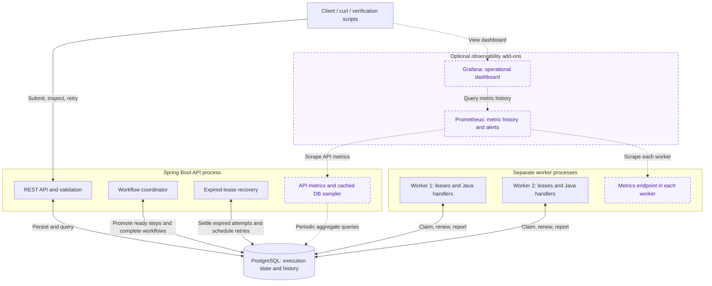

# Distributed Workflow Engine

A Java 21 / Spring Boot distributed DAG workflow engine with parallel execution, persistent state, retries, and worker crash recovery. See the [high-level design](DESIGN.md) for decisions and limitations, and the [Detailed Design](DETAILED_DESIGN.md) for contracts, schema, state transitions, and coordination protocols.

## Quick Start

Requires Docker with Docker Compose running and internet access for initial downloads. Run commands from the repository root. **Host Java, Maven, and PostgreSQL installations are not required for Docker startup.**

### Build and run

Choose one deployment option. Both expose the workflow API at `http://localhost:8080`.

#### With observability

Starts the engine, PostgreSQL, two workers, Prometheus, and Grafana.

**Run:**

```sh
docker compose -f docker-compose.yml -f compose.observability.yml up
```

**Open:**

- [Grafana dashboard](http://localhost:3000/d/dwe-overview) (If not redirect to the dashboard, try to follow: Dashboards --> Workflow Engine --> Workflow Engine -- Operational Overview)
- [Prometheus](http://localhost:9090)

**Tear down** — run in another terminal:

```sh
docker compose -f docker-compose.yml -f compose.observability.yml down
```

#### Without observability

Starts the engine, PostgreSQL, and two workers. This is the assignment's required startup command.

**Run:**

```sh
docker-compose up
```

**Tear down** — run in another terminal:

```sh
docker-compose down
```

Both options build the application image automatically and display logs in the terminal. Leave the services running and use a second terminal for the examples below. `docker compose` and `docker-compose` are equivalent command spellings with modern Compose.

Shutdown retains stored executions. Add `--volumes` to the appropriate teardown command to delete that deployment's database and, when enabled, monitoring data.

### Submit sample workflows

These commands work with either deployment option. Each submission returns an `executionId`; use it in the inspection commands below.

**Sequential execution** — `start → wait → finish`:

```sh
curl --fail -H 'Content-Type: application/json' \
  --data-binary @examples/sequential.json \
  http://localhost:8080/api/v1/executions
```

**Parallel execution** — `start → (branch-b, branch-c) → join → finish`; the join waits for both branches:

```sh
curl --fail -H 'Content-Type: application/json' \
  --data-binary @examples/parallel.json \
  http://localhost:8080/api/v1/executions
```

**Automatic retries** — `work` fails twice, waits 300 then 600 ms, and succeeds on attempt 3:

```sh
curl --fail -H 'Content-Type: application/json' \
  --data-binary @examples/retry.json \
  http://localhost:8080/api/v1/executions
```

**Manual retry** — `work` exhausts three attempts; manual resumption preserves `start` and succeeds on lifetime attempt 4:

```sh
curl --fail -H 'Content-Type: application/json' \
  --data-binary @examples/manual-retry.json \
  http://localhost:8080/api/v1/executions
```

### Inspect an execution and retry failures

Copy an `executionId` from a submission response:

```sh
EXECUTION_ID='paste-returned-id-here'

# Execution status and step summaries
curl --fail "http://localhost:8080/api/v1/executions/$EXECUTION_ID"

# Attempt history, including worker identities and outcomes
curl --fail "http://localhost:8080/api/v1/executions/$EXECUTION_ID/attempts?limit=10"

# List recent executions
curl --fail 'http://localhost:8080/api/v1/executions'
```

Repeat the execution query until `COMPLETED` or `FAILED`. To inspect the sequential example's final output, use its execution ID:

```sh
curl --fail "http://localhost:8080/api/v1/executions/$EXECUTION_ID/steps/finish"
```

For the manual-retry example, set `EXECUTION_ID` to its returned ID and wait until `retryAllowed` is `true`, then run:

```sh
curl --fail -X POST "http://localhost:8080/api/v1/executions/$EXECUTION_ID/retry"
curl --fail "http://localhost:8080/api/v1/executions/$EXECUTION_ID/cycles"
```

### Try a realistic demo: provider record quality

Process five synthetic provider-directory records through parallel normalization and validation, producing four cleaned records and three data-quality findings. Requires Python 3 and the running engine.

```sh
python3 demo/provider-quality/client.py
```

The client prints progress and findings, and exports `report.json` and `cleaned-providers.json` under `provider-output/<execution-id>/`. See [PROVIDER_RECORDS_VALIDATION_DEMO.md](PROVIDER_RECORDS_VALIDATION_DEMO.md) for rules, re-export, retry/crash demonstrations, and verification. The demo uses registered business handlers and existing APIs without special engine coordination or schema changes.

## Runtime Details and Configuration

### Configuration and image builds

Optional local overrides are in [.env.example](.env.example); copy it to `.env` to change host ports or database credentials. Defaults use API port 8080 and database port 5432, both bound to loopback. The examples above assume default ports. This deployment is intended for local evaluation and has no authentication.

Compose builds the application image using the Java/Maven tools in its Docker build stage. The API uses `pull_policy: build`; workers reuse that image with `pull_policy: never`, avoiding application-image registry pulls. Builds reuse cached layers where possible. Run the [Maven tests](#maven-tests) separately to verify the source and integration behavior.

### Background startup, status, and logs

For background startup that waits for services to be running or healthy, use the command matching your deployment option.

**Without observability:**

```sh
docker-compose up -d --wait
docker-compose ps
docker-compose logs --tail=100 api worker
curl --fail http://localhost:8080/actuator/health
```

**With observability:**

```sh
docker compose -f docker-compose.yml -f compose.observability.yml up -d --wait
docker compose -f docker-compose.yml -f compose.observability.yml ps
docker compose -f docker-compose.yml -f compose.observability.yml logs --tail=100 api worker
docker compose -f docker-compose.yml -f compose.observability.yml exec api \
  curl --fail http://localhost:9091/actuator/health/readiness
```

Keep both Compose files in subsequent commands when using observability. Management endpoints move to internal port 9091 in this mode; the business API remains on port 8080. Monitoring ports bind to loopback, and anonymous Grafana viewing is enabled for local evaluation. See [OBSERVABILITY.md](OBSERVABILITY.md) for configuration, metric semantics, failure demonstrations, and cleanup details.

## Architecture Overview



The API validates and persists submissions. The workflow coordinator makes steps eligible after all dependencies complete and finalizes successful workflows. Workers compete for atomic database claims and run registered business handlers outside transactions. Recovery settles expired attempts and applies persisted retry policies. PostgreSQL is both the durable state store and work queue; no separate broker is required.

One Maven artifact runs with either the `api` or `worker` profile. Compose starts two workers with two handler slots each, allowing up to four concurrent handlers. Leases and fencing reject stale state writes. Execution is **at least once**, subject to retry limits: handlers must deduplicate external effects, using the stable execution/step idempotency key where appropriate.

**Purple dashed boxes and dotted connections identify optional observability components.** The API's sampler caches aggregate database observations; Prometheus reads that cache and process metrics through management endpoints, scraping each worker independently. Grafana queries Prometheus for visualization. These components observe execution; workflow progress does not depend on Prometheus or Grafana.

## API Reference and Additional Examples

### Submission and retry behavior

Successful submission returns `201 Created` with an `executionId` and a `Location` header. Execution detail includes step summaries; step detail includes persisted output/error. The [submission schema](src/main/resources/schemas/execution-submission.schema.json) describes the request structure; the server also checks DAG validity and registered actions.

Manual retry returns `200 OK` with the same execution ID and an increased `currentCycleNo`. Completed outputs and history are preserved; failed steps receive fresh per-cycle allowances. Active/completed workflows or unfinished attempts produce `409`. `maxAttempts` includes the first claim, and abandoned claims consume allowance. Automatic retries use capped exponential backoff; permanent errors skip automatic retry.

### Permanent failures and crash recovery

Submit [permanent-failure.json](examples/permanent-failure.json) to see a permanent error fail immediately; an explicit manual retry can succeed:

```sh
curl --fail -H 'Content-Type: application/json' \
  --data-binary @examples/permanent-failure.json \
  http://localhost:8080/api/v1/executions
```

The [recovery example](examples/recovery.json) contains a long-running step used by the [recovery verification script](scripts/verify-recovery.py). See [End-to-end container checks](#end-to-end-container-checks) for automated worker-crash and connectivity-failure demonstrations.

### API reference

All routes below use `/api/v1`:

| Method | Route | Purpose |
| --- | --- | --- |
| POST | `/executions` | Submit a definition and inputs. |
| GET | `/executions` | List execution summaries; optional `status` filter. |
| GET | `/executions/{id}` | Inspect execution and step summaries. |
| GET | `/executions/{id}/steps/{stepId}` | Inspect one step and its output/error. |
| GET | `/executions/{id}/cycles` | Inspect initial/manual-retry cycles. |
| GET | `/executions/{id}/attempts` | Inspect attempts; optional `stepId` and `cycleNo` filters. |
| POST | `/executions/{id}/retry` | Resume a failed execution; no request body. |

```sh
curl --fail 'http://localhost:8080/api/v1/executions?status=FAILED&limit=10'
```

Collection responses contain `items` and `nextCursor`. `limit` defaults to 50, with a maximum of 200. Pass a non-null cursor unchanged as `cursor`, with the same filters, to fetch the next page. Separate pages do not form a frozen snapshot.

## Testing Instructions

### Maven tests

Install a Java 21 JDK and set `JAVA_HOME` to its installation directory. The included Maven Wrapper supplies Maven; check `./mvnw -version` if it selects another JDK. This verification applies to both deployment options and is separate from Docker startup, whose image build skips tests.

```sh
./mvnw test
./mvnw clean verify
```

`test` runs unit tests for validation, handler contracts, retry policies, cursors, and local lease handling. `verify` also runs integration tests against disposable PostgreSQL containers, covering DAG execution, competing claims, fencing, recovery races, retry limits, manual retry, persistence, and API/history behavior. Integration tests require Docker and use a separate database from the local Compose stack. Reports are written to `target/surefire-reports` and `target/failsafe-reports`.

### End-to-end container checks

With Docker running and Python 3 installed, run:

```sh
python3 scripts/verify-delivery.py
python3 scripts/verify-recovery.py
python3 scripts/verify-retries.py
python3 scripts/verify-history.py
python3 scripts/verify-observability.py
python3 scripts/verify-provider-demo.py
```

| Script | Verification |
| --- | --- |
| `verify-delivery.py` | Missing-image Compose startup, sample workflows, branch overlap/join ordering, worker competition, application/database restarts, and retained-volume recreation with queued-work resumption. |
| `verify-recovery.py` | Worker death, worker/database partition, and database pause; abandoned attempts followed by fenced replacement execution. |
| `verify-retries.py` | Automatic/permanent failures, manual resumption, retained history, and restart during persisted backoff. |
| `verify-history.py` | Execution listing, paginated cycles/attempts, filters, errors, and history retained after retry. |
| `verify-observability.py` | Optional-stack provisioning, separate worker scrapes, saturation, worker death, stalled coordination with UP health, database outage/stale data/alerts, monitoring outage isolation, and scale-out discovery. |
| `verify-provider-demo.py` | Provider report/cleaned-data export, re-export without resubmission, transient validation failure/backoff, and worker death/lease recovery with identical business results. Add `--observability --keep` to inspect a retained monitored demo. |

Scripts need no third-party Python packages. Each builds a temporary image and isolated Compose project with disposable ports/storage, then cleans up its own resources. Delivery, observability, and provider-demo checks use ordinary engine defaults; recovery/retry/history fixtures shorten timings. The observability and provider-demo scripts' explicit `--keep` options retain successful stacks for inspection. Allow several minutes, plus initial downloads. Run the full command sequence from a fresh checkout for delivery verification.

## Milestones

The following milestones are complete. See [Milestones.md](Milestones.md) for detailed scope, acceptance criteria, verification records, and the remaining optional roadmap.

| Milestone | Delivered capability |
| --- | --- |
| 1 — Design phase | Architecture, contracts, state model, coordination invariants, and tradeoffs. |
| 2 — Minimal end-to-end implementation | Submission APIs, durable state, registered handlers, and sequential execution. |
| 3 — Parallel DAG execution | Concurrent branches, dependency joins, and competing workers. |
| 4 — Crash recovery | Lease expiry, fencing, worker replacement, and connectivity-failure handling. |
| 5 — Automatic and manual retries | Persisted backoff, retry limits, retry cycles, and preservation of completed work. |
| 6 — Listing and history APIs | Paginated execution, cycle, and attempt inspection. |
| 7 — Reproducible delivery | Compose deployment, runnable examples, and restart/persistence verification. |
| 10a — Observability and failure diagnosis | Optional metrics, structured logs, Prometheus/Grafana, alerts, and fault walkthroughs. |
| Final application demo — Provider records validation | Business handlers plus an external report/export client, with retry and crash demonstrations. |
