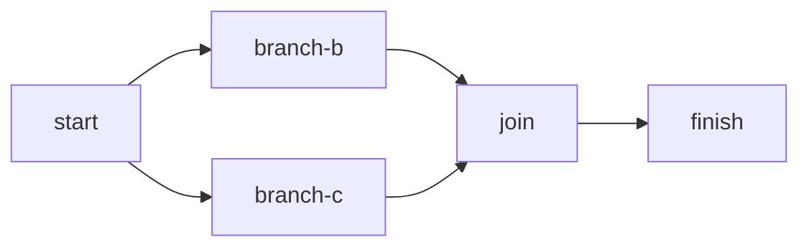

# Distributed Workflow Engine

A Java 21 / Spring Boot application with PostgreSQL-backed workflow state and leased worker claims. Maven builds a single artifact that runs as either an API/coordinator or a worker process. The approved architecture is in [DESIGN.md](DESIGN.md); the current milestone breakdown is in [Milestones.md](Milestones.md), with earlier planning and environment checks in [Plan.md](Plan.md).

## Current implementation: milestone 4

This checkpoint implements validated submission, execution and step queries, Flyway-managed storage, handler registration, conditional claims, lease renewal, fencing, durable outcome reporting, sequential/parallel DAG execution, and expired-attempt recovery. Compose starts two worker containers by default, each with two handler slots. `ECHO` and `DELAY` are predefined demonstration handlers. API and workers run in separate containers using the same image.

This is not the complete assignment. Recovery now settles expired attempts as `ABANDONED` and schedules another attempt when the workflow is active and allowance remains. Expiry exhausting the allowance fails the workflow; expired siblings on already-failed workflows are settled without retry. Complete retry/manual-retry coverage remains milestone 5; listing/history APIs remain milestone 6.

## Prerequisites and build

- Java 21 JDK and Docker Desktop (or a compatible Docker daemon) running.
- Maven Wrapper included; system Maven 3.9+ also works.
- Initial builds need internet access for Maven dependencies and container images.

On the validated macOS environment, select Java 21 explicitly because system Maven otherwise selects Java 26:

```sh
export JAVA_HOME=/Library/Java/JavaVirtualMachines/temurin-21.jdk/Contents/Home
./mvnw clean verify
```

Use the path to your own Java 21 installation on other machines. Maven Enforcer rejects unsupported Java versions. `verify` runs unit tests and PostgreSQL integration tests through Testcontainers; it fails if Docker is unavailable. `./mvnw test` runs unit tests only. The test database is disposable and separate from the Compose database. No host PostgreSQL installation is needed.

## Run with Docker Compose

```sh
docker-compose up --build -d --wait
docker-compose ps
```

`docker compose` is equivalent. The image uses pinned Java 21 JDK/JRE bases, a multi-stage Maven build, and a non-root runtime user. Unit/integration verification runs separately from the image build; its packaging stage skips test execution.

The API listens on `http://localhost:8080`; PostgreSQL is published on loopback port 5432. Defaults are suitable for local development. Optional overrides are shown in [.env.example](.env.example); copy it to `.env` if needed. `API_PORT` and `DB_PORT` change host ports. Compose applications always use PostgreSQL's internal port 5432.

```sh
curl --fail http://localhost:8080/actuator/health
curl --fail -i -H 'Content-Type: application/json' \
  --data-binary @examples/sequential.json http://localhost:8080/api/v1/executions
```

The submission returns `201 Created`, an `executionId`, and a `Location` header. Substitute that ID below:

```sh
curl --fail http://localhost:8080/api/v1/executions/EXECUTION_ID
curl --fail http://localhost:8080/api/v1/executions/EXECUTION_ID/steps/finish
docker-compose logs --tail=100 api worker
```

The sample runs `start → wait → finish`; the final step receives the direct `wait` output. Execution detail includes the submitted definition snapshot and resolved step statuses. Step detail includes effective retry settings, dependency IDs, attempt count, and persisted output/error. The standalone [submission schema](src/main/resources/schemas/execution-submission.schema.json) describes structural validation; DAG and registered-handler validation are additional server-side checks.

### Parallel branches and a join

Submit the parallel sample, then query its execution and `join` step using the returned ID:

```sh
curl --fail -i -H 'Content-Type: application/json' \
  --data-binary @examples/parallel.json http://localhost:8080/api/v1/executions
curl --fail http://localhost:8080/api/v1/executions/EXECUTION_ID
curl --fail http://localhost:8080/api/v1/executions/EXECUTION_ID/steps/join
```



The branches use `DELAY` for 3 and 5 seconds. They may run in the same worker or different workers; the join waits for both and returns their outputs under `dependencies`. Assignment is competitive rather than round-robin, so equal work distribution is not guaranteed. `docker-compose ps worker` shows both replicas, and `docker-compose logs worker` includes each process's worker ID.

For timestamp/ownership inspection before the history API is implemented, this read-only query uses the default local database credentials:

```sh
docker-compose exec -T postgres psql -U dwe -d dwe -c \
  "SELECT step_id, worker_id, started_at, finished_at, status FROM step_attempt WHERE workflow_id = 'EXECUTION_ID' ORDER BY started_at, step_id;"
```

The branch intervals should overlap; the join starts after both branches finish. Adjust `-U` and `-d` if you override the database credentials. To change the number of workers locally, use `docker-compose up -d --scale worker=3`; every worker still claims only up to its own configured capacity.

### Persistence across application restart

To demonstrate persistence, wait for `COMPLETED`, restart application processes, and query the same ID:

```sh
docker-compose restart api worker
curl --fail http://localhost:8080/api/v1/executions/EXECUTION_ID
```

Wait for the API to become healthy after restart. Stop local services without deleting the named database volume:

```sh
docker-compose down
```

### Crash and connectivity recovery

With Docker running and Python 3 installed, run the portable container checks from the repository root:

```sh
python3 scripts/verify-recovery.py
```

The script builds a uniquely tagged image and starts a separate Compose project on disposable host ports. It submits [recovery.json](examples/recovery.json), kills the owning worker, and verifies that the surviving worker completes a replacement attempt. It then checks a worker disconnected from the database network and a full PostgreSQL pause. Each case checks `ABANDONED → replacement COMPLETED` history, an increased attempt token, persisted backoff, and successful downstream execution. Tests use a 5-second lease and faster polling only in their temporary configuration; normal deployment defaults remain unchanged. Allow roughly one to two minutes on a warm Docker cache, plus build/startup time.

Fault injection and cleanup affect only the uniquely named verification project. The script reconnects/unpauses its containers on error and removes its own containers, database volume, and temporary image afterward. The user's default Compose project and database volume are preserved. The script requires no third-party Python packages and is separate from Maven verification.

To submit the recovery example to the ordinary local stack, use:

```sh
curl --fail -i -H 'Content-Type: application/json' \
  --data-binary @examples/recovery.json http://localhost:8080/api/v1/executions
```

An abandoned attempt is an ownership observation, not proof that business code or external side effects stopped. The former owner cannot renew an expired lease or overwrite replacement results. Attempts abandoned after a crash or partition count against the step's total attempt limit, just like other claimed attempts.

## Local Java processes

Start only the database, package the application, and run the roles in separate terminals:

```sh
docker-compose up -d postgres
./mvnw package
java -jar target/dwe.jar --spring.profiles.active=api
# In another terminal:
java -jar target/dwe.jar --spring.profiles.active=worker
```

The worker profile starts without an HTTP server. Enabling both roles in the same process fails startup. Database defaults match Compose; override `DB_HOST`, `DB_PORT`, `POSTGRES_DB`, `POSTGRES_USER`, and `POSTGRES_PASSWORD` as needed. The API profile is the default if no profile is specified.

## Execution and handler contract

The coordinator exposes a pending step for claiming only when every dependency is completed. Claims and lifecycle changes use short database transactions guarded by the workflow row; business handlers run outside transactions. Heartbeats update only the claimed step. Result writes require the current worker ID, lifetime attempt token, cycle, running state, and an unexpired database lease. A terminal attempt's stored outcome is immutable. After a result-write exception, the worker reads the exact attempt's terminal outcome before retrying persistence; neither reconciliation nor another report invokes the handler again.

Worker capacity defaults to two simultaneous handlers per process, for up to four across the two default Compose workers. Leases last 30 seconds, heartbeats run every 5 seconds, and the worker stops local work before its last confirmed lease can expire. Heartbeats and deadline checks use separate executors from handlers. Shutdown stops claiming and drains work for up to 30 seconds before requesting interruption. Cancellation is cooperative; a handler that ignores interruption keeps its slot until it exits.

Recovery scans up to 100 expired candidates per pass every 5 seconds (`engine.recovery-interval`, overridable as `ENGINE_RECOVERY_INTERVAL`). Each candidate is rechecked against database time after the workflow/step locks; a heartbeat committed while recovery waited prevents false abandonment. With a healthy coordinator/database, expiry detection is ordinarily within about 35 seconds of the last extension, with backoff, load, and polling adding time before replacement execution. This is not a strict deadline or a step execution timeout. A healthy handler can keep renewing indefinitely.

Implement `StepHandler`, expose it as a Spring bean, and rebuild the application to add an action type. Duplicate registrations fail startup; unknown types are rejected at submission. API and worker deployments must use the same registered set. `inputs`, `parameters`, and successful outputs are JSON objects. Each invocation receives isolated JSON and only direct dependency outputs. `ECHO` returns those inputs, parameters, and dependencies; `DELAY` requires an integer `durationMs` between 0 and 60000.

Delivery semantics are **at least once**, not exactly once. Fencing protects engine records, not external side effects. Handlers should use the stable execution/step idempotency key or another appropriate deduplication mechanism. Unexpected ordinary exceptions are retryable; typed permanent failures fail the workflow immediately. Automatic backoff and abandonment limits are implemented; full retry/manual-retry acceptance remains milestone 5. Pending/retrying steps fail when the workflow fails; independent already-running steps may finish without reopening the workflow.

No authentication, external-code execution, recurring schedules, cancellation API, compensation, or production deployment hardening is included in this checkpoint. Large-workflow query batching and database tuning also remain future work.

## Verification coverage

- Unit tests: structural and DAG validation, per-field retry defaults, immutable submission snapshot, handler registry, isolated handler context, cancellation, and overflow-safe backoff calculation.
- PostgreSQL integration tests: migration repeatability, submission rollback, relational/JSON constraints, HTTP payloads and errors, exclusive competing claims, stale/expired ownership rejection, immutable duplicate reports, finite eligibility at the supported backoff boundary, permanent failure propagation, invalid handler output, sequential execution, worker restart retention, and heartbeat renewal beyond the original lease.
- Milestone 3 integration tests: gated parallel branches and join outputs, two real worker runtimes competing for one step, per-worker capacity with excess work left unclaimed, failure racing with claims/completion in both transaction orders, failure of waiting retry steps, and conflicting concurrent outcome reports. Lock-race tests observe PostgreSQL's blocking sessions to establish ordering rather than relying on sleeps.
- Milestone 4 tests: abandonment/backoff and allowance exhaustion, failed-workflow cleanup, competing recovery passes, heartbeat/recovery races, expiry after lock waits, stale-result rejection, lost claim/result responses, pre-commit write failure, transient renewal failure, graceful draining, and handlers that ignore interruption. Local deadline tests inject renewal responses; PostgreSQL integration tests verify durable ownership and history independently.
- Container smoke test: build the shared image, start API/worker/PostgreSQL with the assignment's `docker-compose` command, submit the sample through HTTP, and verify stored results after application restart.
- Portable container recovery verification: `scripts/verify-recovery.py` exercises actual process death, worker network isolation, and PostgreSQL unavailability using disposable infrastructure.

Maven reports are under `target/surefire-reports` and `target/failsafe-reports`. Run milestone 3 integration tests with `./mvnw -Dit.test=ParallelWorkflowIT,WorkflowConcurrencyIT verify`, or milestone 4 integration tests with `./mvnw -Dit.test=LeaseRecoveryIT,WorkerFailureIT verify`. Both commands also run unit tests. Later milestones add complete retry/API coverage and final delivery verification.
