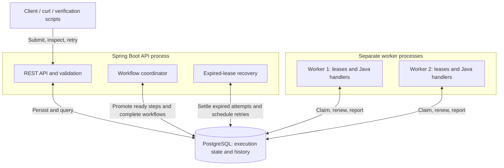

# Distributed Workflow Engine

A Java 21 / Spring Boot engine that executes directed acyclic graph (DAG) workflows across multiple workers. PostgreSQL preserves execution state, results, and history, and coordinates claims, retries, and crash recovery. See the [high-level design](DESIGN.md) for decisions and limitations, and the [Detailed Design](DETAILED_DESIGN.md) for contracts, schema, state transitions, and coordination protocols.

## Quick Start

### Prerequisites

- Docker with Docker Compose and a running daemon.
- Java 21 JDK for host-side Maven builds. The included Maven Wrapper supplies Maven; set `JAVA_HOME` to your Java 21 installation.
- Internet access for initial dependency and image downloads. Python 3 is needed for the container verification scripts.

Run commands from the repository root. No host PostgreSQL installation is required.

### Build and run locally

```sh
./mvnw clean verify
docker-compose up
```

`verify` builds the application and runs unit and PostgreSQL integration tests; Docker must be available. Compose builds the application image locally and starts PostgreSQL, the API/coordinators, and two workers. The API uses `pull_policy: build`; workers reuse that image with `pull_policy: never`, avoiding application-image registry pulls. Builds reuse cached layers where possible. `docker compose` is an equivalent command spelling. The container build supplies its own Java/Maven tools and skips tests, so run verification separately.

Leave the foreground services running and use a second terminal for the HTTP examples.

For detached startup and rebuilding after source changes:

```sh
docker-compose up --build -d --wait
docker-compose ps
curl --fail http://localhost:8080/actuator/health
```

The API is available at `http://localhost:8080`. Optional local overrides are in [.env.example](.env.example); copy it to `.env` to change host ports or database credentials. Defaults use API port 8080 and database port 5432, both bound to loopback. If Maven selects another JDK, check `JAVA_HOME` and `./mvnw -version`.

```sh
docker-compose logs --tail=100 api worker
docker-compose down
```

`down` retains the named PostgreSQL volume and stored executions. Removing that volume deletes their state. This deployment is intended for local evaluation and has no authentication.

## Architecture Overview



The API validates and persists submissions. The workflow coordinator makes steps eligible after all dependencies complete and finalizes successful workflows. Workers compete for atomic database claims and run registered business handlers outside transactions. Recovery settles expired attempts and applies persisted retry policies. PostgreSQL is both the durable state store and work queue; no separate broker is required.

One Maven artifact runs with either the `api` or `worker` profile. Compose starts two workers with two handler slots each, allowing up to four concurrent handlers. Leases and fencing reject stale state writes. Execution is **at least once**, subject to retry limits: handlers must deduplicate external effects, using the stable execution/step idempotency key where appropriate.

### Optional monitoring dashboard

```sh
docker compose -f docker-compose.yml -f compose.observability.yml up --build -d --wait
```

Open the provisioned [Grafana dashboard](http://localhost:3000/d/dwe-overview) and [Prometheus](http://localhost:9090). The dashboard shows work waiting, worker capacity, execution outcomes, control-loop activity, ownership/recovery, database pressure, and alerts. Monitoring ports bind to loopback; management endpoints remain inside the container network. Ordinary startup stays unchanged. See [OBSERVABILITY.md](OBSERVABILITY.md) for configuration, metric semantics, the failure walkthrough, and cleanup instructions. Local anonymous Grafana viewing is enabled for this evaluation deployment.

## Example Usage

### Provider records validation demo

The business demo processes five synthetic provider-directory records through parallel normalization and validation, producing four cleaned records and three data-quality findings. With the current application image running, use the standalone HTTP client:

```sh
python3 demo/provider-quality/client.py
```

It prints progress/findings and exports `report.json` and `cleaned-providers.json` under `provider-output/<execution-id>/`. See [PROVIDER_RECORDS_VALIDATION_DEMO.md](PROVIDER_RECORDS_VALIDATION_DEMO.md) for rules, re-export, retry/crash demonstrations, and verification. Presentation uses existing APIs; the engine, worker runtime, API server, schema, and monitoring are unchanged.

### Submit and monitor a workflow

The [sequential example](examples/sequential.json) runs `start → wait → finish`:

```sh
curl --fail -i -H 'Content-Type: application/json' \
  --data-binary @examples/sequential.json \
  http://localhost:8080/api/v1/executions
```

The response is `201 Created` with an `executionId` and a `Location` header. Set the returned ID, then inspect progress and results:

```sh
EXECUTION_ID='paste-returned-id-here'
curl --fail "http://localhost:8080/api/v1/executions/$EXECUTION_ID"
curl --fail "http://localhost:8080/api/v1/executions/$EXECUTION_ID/steps/finish"
curl --fail "http://localhost:8080/api/v1/executions/$EXECUTION_ID/attempts?limit=10"
```

Repeat the execution query until `COMPLETED` or `FAILED`. Execution detail includes step summaries; step detail includes persisted output/error. Attempt history includes worker IDs, timing, and outcomes. The [submission schema](src/main/resources/schemas/execution-submission.schema.json) describes the request structure; the server also checks DAG validity and registered actions.

### Try parallel execution, retries, and recovery

Submit these files with the same POST command, changing the filename:

| Sample | Expected behavior |
| --- | --- |
| [parallel.json](examples/parallel.json) | `start → (branch-b, branch-c) → join → finish`; branches overlap and the join waits for both. |
| [retry.json](examples/retry.json) | `work` fails twice, waits 300 then 600 ms, and succeeds on attempt 3. |
| [manual-retry.json](examples/manual-retry.json) | `work` exhausts three attempts; manual retry preserves `start` and succeeds on lifetime attempt 4. |
| [permanent-failure.json](examples/permanent-failure.json) | A permanent error fails immediately; an explicit manual retry can succeed. |
| [recovery.json](examples/recovery.json) | A long-running step used by the worker-crash and connectivity verification script. |

Set `EXECUTION_ID` to the failed example's returned ID. Wait until `retryAllowed` is true, then send a bodyless request:

```sh
curl --fail -X POST "http://localhost:8080/api/v1/executions/$EXECUTION_ID/retry"
curl --fail "http://localhost:8080/api/v1/executions/$EXECUTION_ID/cycles"
```

Retry returns `200 OK` with the same ID and an increased `currentCycleNo`. Completed outputs and history are preserved; failed steps receive fresh per-cycle allowances. Active/completed workflows or unfinished attempts produce `409`. `maxAttempts` includes the first claim, and abandoned claims consume allowance. Automatic retries use capped exponential backoff; permanent errors skip automatic retry.

### API reference

All routes below use `/api/v1`:

| Method | Route | Purpose |
| --- | --- | --- |
| POST | `/executions` | Submit a definition and inputs. |
| GET | `/executions` | List execution summaries; optional `status` filter. |
| GET | `/executions/{id}` | Inspect execution and step summaries. |
| GET | `/executions/{id}/steps/{stepId}` | Inspect one step and its output/error. |
| GET | `/executions/{id}/cycles` | Inspect initial/manual-retry cycles. |
| GET | `/executions/{id}/attempts` | Inspect attempts; optional `stepId` and `cycleNo` filters. |
| POST | `/executions/{id}/retry` | Resume a failed execution; no request body. |

```sh
curl --fail 'http://localhost:8080/api/v1/executions?status=FAILED&limit=10'
```

Collection responses contain `items` and `nextCursor`. `limit` defaults to 50, with a maximum of 200. Pass a non-null cursor unchanged as `cursor`, with the same filters, to fetch the next page. Separate pages do not form a frozen snapshot.

## Testing Instructions

### Maven tests

```sh
./mvnw test
./mvnw clean verify
```

`test` runs unit tests for validation, handler contracts, retry policies, cursors, and local lease handling. `verify` also runs integration tests against disposable PostgreSQL containers, covering DAG execution, competing claims, fencing, recovery races, retry limits, manual retry, persistence, and API/history behavior. Integration tests require Docker and use a separate database from the local Compose stack. Reports are written to `target/surefire-reports` and `target/failsafe-reports`.

### End-to-end container checks

With Docker running and Python 3 installed, run:

```sh
python3 scripts/verify-delivery.py
python3 scripts/verify-recovery.py
python3 scripts/verify-retries.py
python3 scripts/verify-history.py
python3 scripts/verify-observability.py
python3 scripts/verify-provider-demo.py
```

| Script | Verification |
| --- | --- |
| `verify-delivery.py` | Missing-image Compose startup, sample workflows, branch overlap/join ordering, worker competition, application/database restarts, and retained-volume recreation with queued-work resumption. |
| `verify-recovery.py` | Worker death, worker/database partition, and database pause; abandoned attempts followed by fenced replacement execution. |
| `verify-retries.py` | Automatic/permanent failures, manual resumption, retained history, and restart during persisted backoff. |
| `verify-history.py` | Execution listing, paginated cycles/attempts, filters, errors, and history retained after retry. |
| `verify-observability.py` | Optional-stack provisioning, separate worker scrapes, saturation, worker death, stalled coordination with UP health, database outage/stale data/alerts, monitoring outage isolation, and scale-out discovery. |
| `verify-provider-demo.py` | Provider report/cleaned-data export, re-export without resubmission, transient validation failure/backoff, and worker death/lease recovery with identical business results. Add `--observability --keep` to inspect a retained monitored demo. |

Scripts need no third-party Python packages. Each builds a temporary image and isolated Compose project with disposable ports/storage, then cleans up its own resources. Delivery, observability, and provider-demo checks use ordinary engine defaults; recovery/retry/history fixtures shorten timings. The observability and provider-demo scripts' explicit `--keep` options retain successful stacks for inspection. Allow several minutes, plus initial downloads. Run the full command sequence from a fresh checkout for delivery verification.
